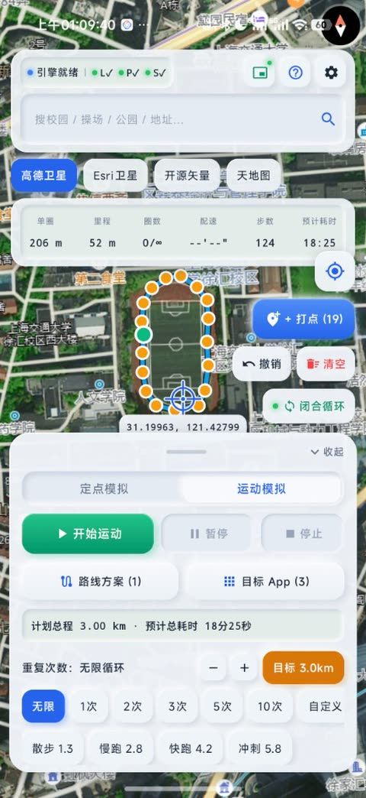
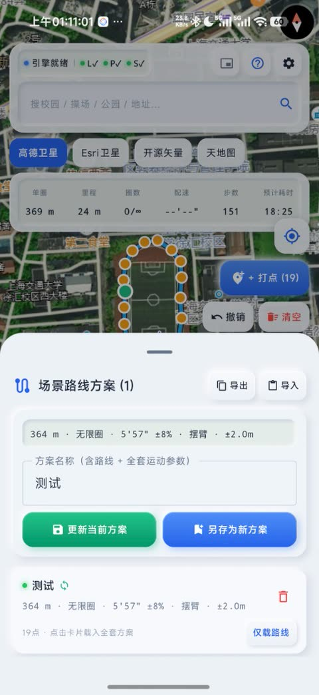
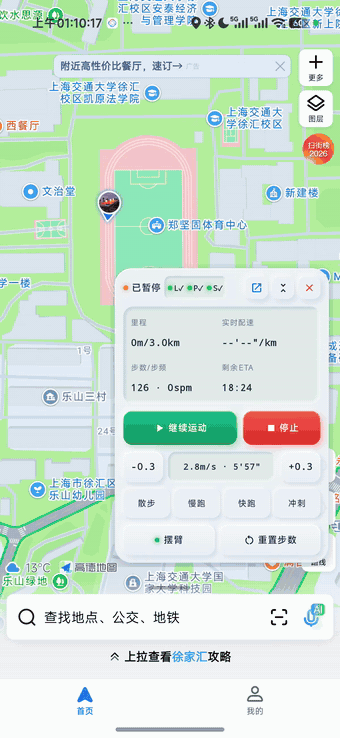

<p align="center">
  
</p>
<p align="center"><em>Teleport!!!</em></p>
<h1 align="center">Kuroko Teleport</h1>
<p align="center">
  面向 Android 的系统侧单应用虚拟定位、计步与运动仿真引擎（目标 App 零注入）
  <br/>
  简体中文 | <a href="README_EN.md">English</a>
</p>

---

## 核心特性

- **目标 App 零注入 · 按应用精准隔离**：所有定位、网络脱敏与传感器仿真均在系统服务层按调用方 UID 隔离完成，绝不向目标 App 进程注入代码或修改其内存；支持同时管理最多 32 个目标应用，未勾选应用及主控端自身始终直通真实物理硬件。
- **定点模拟与拟真轨迹运动**：内置开源地图（无 Google Play 依赖）、地名搜索、收藏点位库与可复用路线方案（支持 JSON 导入导出）；支持平滑弯道轨迹、循环/圈数/目标里程自动收尾、自然配速波动，以及手持摆臂 / 裤兜携带姿态切换。
- **室内静止全链路计步与 IMU 同步**：即使手机平放室内桌面无真实卫星信号，也能稳定输出虚拟定位、多星座卫星/NMEA、单调递增步数与同源相位运动传感器数据；设置页内置「计步 / IMU 传感器自检」开箱即验。
- **单应用 Wi-Fi / 基站防泄漏策略**：每个目标应用可独立配置 **跨城严防**（隐藏周边 Wi-Fi、蜂窝基站并抑制原始 GNSS 观测）或 **同城户外**（隐藏 Wi-Fi 并保留本地基站），避免网络辅助定位穿帮。
- **后台悬浮控制窗与防截屏保护**：支持切后台自动浮现的贴边迷你胶囊与展开控制台、通知栏快捷启停，以及动态 `FLAG_SECURE` 防截屏开关，无需反复切回主界面。
- **All-in-One 一键刷入 · 自动防砖 · 诊断中心与双语切换**：单个 KernelSU 模块包自动安装配套 App 并即时回收存储空间；内置四端版本锁定校验、`boot-guard` 自动防砖、一键诊断与脱敏日志导出，以及简体中文 / English 实时切换（支持系统「应用语言」）。

---

## 界面预览

<table>
  <tr>
    <td align="center" width="33%">
      <br/>
      <sub><strong>运动模拟 &amp; 轨迹绘制</strong></sub>
    </td>
    <td align="center" width="33%">
      <br/>
      <sub><strong>场景路线方案与导入导出</strong></sub>
    </td>
    <td align="center" width="33%">
      <br/>
      <sub><strong>后台悬浮窗实机演示（GIF）</strong></sub>
    </td>
  </tr>
</table>

---

## 适用环境

| 项目 | 要求 | 说明 |
| :--- | :--- | :--- |
| **CPU 架构** | `arm64-v8a` | 仅支持 64 位 ARM 设备 |
| **Android 版本** | **Android 12+** (`minSdk 31`) | App 与 Native 引擎均面向 Android 12+（`android-31`）编译，内置 **Android 12–17 多版本传感器符号匹配**（已在 Android 17 真机完成全链路验证；欢迎 Android 12–16 机型用户通过诊断包反馈适配情况） |
| **Root 框架** | **KernelSU / KSU2** | 用于刷入 All-in-One 模块、开机拉起后台引擎与注入 SELinux 策略 |
| **Zygisk** | **Zygisk Next** (API v4) | 用于系统侧传感器与计步仿真 |
| **Xposed** | **LSPosed** | **仅勾选「系统框架 (`android`)」与「电话服务 (`com.android.phone`)」，切勿勾选目标 App** |

---

## 快速安装与上手

> [!IMPORTANT]
> **切勿在 LSPosed 中勾选任何目标第三方 App**。Kuroko Teleport 通过系统服务层按 UID 分流生效，只需启用系统框架与电话服务即可。

1. **刷入 All-in-One 模块包**
   - 将 `dist/kuroko-teleport-ksu-module.zip` 推送至手机，在 **KernelSU 管理器 → 模块 → 从本地安装** 中刷入。
   - 安装脚本会自动校验并流式安装主控 App（`com.kuroko.teleport`），完成后立即清理安装包释放空间；若在 Recovery 等离线环境刷入，开机后会自动补装。
   - 确认 **Zygisk Next** 已启用。
2. **配置 LSPosed 作用域（仅首次安装需配置）**
   - 打开 **LSPosed 管理器 → 模块 → Kuroko Teleport**，开启总开关。
   - 在作用域中**仅勾选**以下两项系统组件：
     - `[x]` **系统框架 (`android`)**
     - `[x]` **电话服务 (`com.android.phone`)**
3. **重启设备**
   - 重启手机，使后台守护进程、Zygisk 传感器模块与 LSPosed 系统侧 Hook 同步加载生效。
4. **打开主控 App 开始使用**
   - 启动桌面 **Kuroko Teleport**，首次连接授予 Root 权限（仅用于读取当次开机鉴权令牌）。
   - 确认顶栏三个状态指示灯呈 **`L✓ P✓ S✓`** 绿色就绪（可在 **设置** 中切换语言或运行 **「计步 / IMU 传感器自检」**）。
   - 点击底部 **「目标 App」** 选择需要生效的应用与隔离策略，切换 **「定点模拟」** 或 **「运动模拟」** 即可开始；跑满目标圈数/里程后引擎自动原地停留，在目标 App 保存记录后再点击 **「停止」**。

---

## 常见问题（FAQ）

<details>
<summary><strong>为什么不能在 LSPosed 中勾选目标 App？</strong></summary>

Kuroko Teleport 的核心设计是「目标 App 零注入」：所有伪造与隔离均在 `system_server` 与 `com.android.phone` 按 UID 精确生效。勾选目标 App 不仅多余，还会破坏零注入隐蔽性，增加被应用层环境检测识别的风险。

</details>

<details>
<summary><strong>升级或卸载模块会删除已保存的路线、收藏点位和设置吗？</strong></summary>

不会。覆盖刷入新版本会直接保留全部路线、点位、偏好设置与 LSPosed 作用域；在 KernelSU 中卸载模块时，卸载脚本仅清理后台进程与运行态目录，**绝不卸载主控 App**，用户数据完整保留。

</details>

<details>
<summary><strong>如果刷入后出现开机异常怎么办？（<code>boot-guard</code> 自动防砖与紧急禁用）</strong></summary>

每次开机 `boot-guard` 会自动计数并在成功进桌面后归零；若连续 2 次未能完成开机，系统将自动熔断并跳过全部 Hook 恢复纯净启动。你也可以通过 ADB 手动禁用模块：

```bash
adb shell su -c "touch /data/adb/modules/kuroko_teleport/disable && reboot"
```

</details>

<details>
<summary><strong>后台悬浮窗被系统清理或切换后台后消失怎么办？</strong></summary>

请在系统 **「应用信息 → 电量 / 省电策略」** 中将 **Kuroko Teleport** 设为 **「无限制」**，并允许通知与悬浮窗权限，避免长时间息屏或切后台时被系统省电策略回收。

</details>

<details>
<summary><strong>遇到问题如何自查或提交 Bug 反馈？</strong></summary>

打开应用内 **设置 → 诊断与日志**（或在引擎离线/版本锁定弹窗中点击 **查看诊断日志**），即可运行 5 项自动体检并分标签查看诊断日志。提交 GitHub Issue 时，请点击 **「复制摘要」** 粘贴脱敏 Markdown 摘要，必要时通过 **「分享诊断包 / 保存文件」** 附带导出 ZIP（鉴权令牌、地图 Key、路线坐标与无关应用日志均会自动脱敏，且默认匿名化目标 App 包名）。

</details>

---

## 计划功能（TODO）

- [x] 系统侧 GPS / GNSS / NMEA、室内静止计步与 IMU 同步、Wi-Fi 与基站防泄漏、后台悬浮控制窗、中英双语切换及脱敏诊断日志导出
- [ ] Android 12–16 多机型真机验证与厂商 ROM 适配完善（已内置 `android-31` 编译基线与多版本传感器符号匹配）
- [ ] 海外 GMS 融合定位提供器（FLP）支持
- [ ] 虚拟 4G/5G 蜂窝基站伪造
- [ ] 虚拟周边 Wi-Fi 列表伪造
- [ ] 蓝牙 / BLE 扫描隔离与虚拟信标伪造
- [ ] GPX / KML 轨迹导入与 360° 悬浮方向摇杆

完整工程待办清单请参见 [docs/TODOLIST.md](docs/TODOLIST.md)。

---

## 从源码构建、多语言贡献与开发文档

### 构建环境与命令

需准备 **OpenJDK 21**、**Android SDK / NDK** 与 **Python 3.10+**，在仓库根目录依次执行：

```bash
# 1. 编译主控 App 与 LSPosed 模块合一 APK（Windows 可用 .\gradlew.bat）
./gradlew :app:assembleDebug

# 2. 编译 Native 二进制并打包 All-in-One KernelSU 模块（输出 dist/kuroko-teleport-ksu-module.zip）
python build_module.py
```

### 贡献新语言

本项目采用数据驱动多语言架构，新增语种无需修改业务逻辑：添加 `app/src/main/res/values-<bcp47>/strings*.xml`，在 `locales_config.xml` 与 `AppLocaleManager.kt` 注册语言条目，并可选在 `module_template/lang/` 添加对应安装脚本词典即可（详见架构文档）。

### 深入文档

- **[深度技术架构文档 (`docs/ARCHITECTURE.md`)](docs/ARCHITECTURE.md)** — 系统分层架构、共享内存与 IPC 协议、Native 纯 PLT/GOT 传感器注入与运动学/IMU 数学模型。
- **[演进路线图 (`docs/ROADMAP.md`)](docs/ROADMAP.md)** — 各阶段规划（含虚拟基站、虚拟 Wi-Fi、蓝牙/BLE 隔离与伪造、GMS FLP 及 Android 12–17 多版本适配）。
- **[工程待办清单 (`docs/TODOLIST.md`)](docs/TODOLIST.md)** — 按子系统拆分的已完成项与后续迭代可勾选任务。

---

## 社区支持

欢迎在 **[LINUX DO](https://linux.do)** 社区交流使用体验、分享多机型兼容性测试反馈与功能建议；如遇具体异常或需提交 Android 12–16 适配诊断日志，也可直接通过 **GitHub Issues** 附带应用内导出的脱敏诊断摘要进行反馈。

---

## 免责声明

本项目仅供软件开发调试、定位安全研究与个人隐私保护学习使用。请严格遵守所在地区法律法规及第三方平台服务条款，因不当使用引发的任何后果由使用者自行承担。
