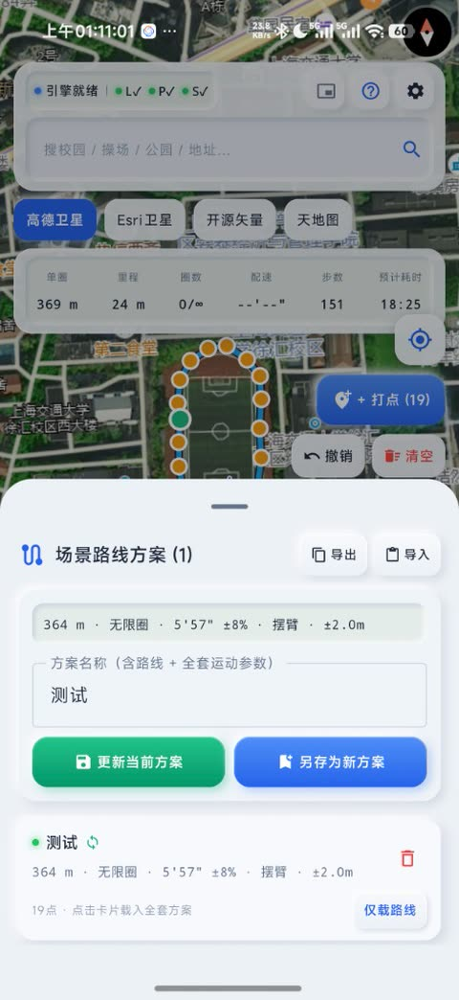
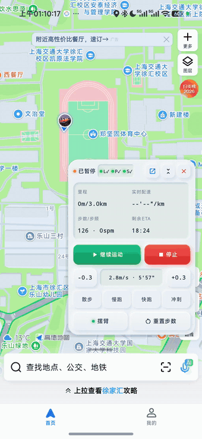

<p align="center">
  
</p>
<p align="center"><em>Teleport!!!</em></p>
<h1 align="center">Kuroko Teleport</h1>
<p align="center">
  Per-app system-side GPS, pedometer &amp; IMU simulation engine for Android — zero target app injection.
  <br/>
  <a href="README.md">简体中文</a> | English
</p>

---

## Key Features

- **Zero Target-App Injection & Per-App Isolation**: All location, network sanitization, and sensor simulation happens strictly on the Android system side per calling UID — target app processes and memory are never hooked or modified. Isolate up to 32 target apps simultaneously while unselected apps and the controller itself continue receiving genuine hardware GPS and sensors.
- **Static Pin & Realistic Route Motion**: Built-in open-source map (no Google Play Services required) with address search, saved pins, and reusable route presets (JSON import/export). Supports smooth curved paths, loop / lap-count / target-distance completion, natural pace variation, and hand-swing or pocket carry postures.
- **Stationary Indoor Pedometer & IMU Sync**: Delivers synthetic GPS, multi-constellation GNSS/NMEA, monotonically increasing steps, and phase-synchronized motion sensors even while your phone rests completely still indoors — complete with a built-in **Sensor Self-Test** in Settings.
- **Global RF Signal Simulation & Anti-Leak (4G/5G Cell, Wi-Fi & BLE)**: Pick per-app presets (**Full Spoof / Strict Hide / Local Outdoor**) or fine-tune Cell, Wi-Fi, and BLE independently (`Pass / Hide / Spoof`). Automatically synthesizes geo-aware regional 4G/5G cell towers & network/SIM country codes, nearby virtual Wi-Fi AP lists (regional SSIDs/OUIs/channels, 802.11d country code & optional virtual connected AP), plus Bluetooth/BLE scan suppression & custom iBeacon spoofing (with one-tap local scan import and zero impact on paired headphones/watches).
- **Background Floating HUD & Screen-Capture Protection**: Edge-snapping floating capsule and expandable mini control panel that auto-appears when backgrounded, notification quick controls, and a dynamic `FLAG_SECURE` screen-capture hiding toggle.
- **All-in-One Install, Boot-Guard, Diagnostics & Live Language Switch**: A single KernelSU module ZIP auto-installs the companion App and immediately reclaims storage, verifies strict cross-component version alignment, protects against bootloops via `boot-guard`, includes a built-in Diagnostics & Logs center (auto health checks + redacted log export), and supports instant Simplified Chinese / English switching.

---

## Screenshots & Demo

<table>
  <tr>
    <td align="center" width="33%">
      <br/>
      <sub><strong>Route Motion &amp; Waypoints</strong></sub>
    </td>
    <td align="center" width="33%">
      <br/>
      <sub><strong>Saved Route Presets &amp; Export</strong></sub>
    </td>
    <td align="center" width="33%">
      <br/>
      <sub><strong>Floating HUD Live Demo (GIF)</strong></sub>
    </td>
  </tr>
</table>

---

## Requirements

| Component | Requirement | Notes |
| :--- | :--- | :--- |
| **Architecture** | `arm64-v8a` | 64-bit ARM devices only |
| **Android Version** | **Android 12+** (`minSdk 31`) | Both App and native binaries target Android 12+ (`android-31`) with built-in **Android 12–17 multi-version sensor symbol matching** (verified on Android 17; real-device feedback on Android 12–16 is welcome via Diagnostics export) |
| **Root Framework** | **KernelSU / KSU2** | Installs the All-in-One module, starts the background daemon at boot, and applies SELinux rules |
| **Zygisk** | **Zygisk Next** (API v4) | Powers system-side pedometer and IMU simulation |
| **Xposed** | **LSPosed** | Check **ONLY** `System Framework (android)` and `Phone Services (com.android.phone)` (optionally check `Bluetooth (com.android.bluetooth)` for BLE isolation/spoofing) — **never check target apps** |

---

## Quick Installation & Usage

> [!IMPORTANT]
> **NEVER check any target third-party app in LSPosed.** Kuroko Teleport isolates apps by UID inside system services — only System Framework, Phone Services, and optionally Bluetooth should be enabled.

1. **Flash the All-in-One Module ZIP**
   - Push `dist/kuroko-teleport-ksu-module.zip` to your device and install it in **KernelSU Manager → Modules → Install from local**.
   - The installer verifies and installs the companion App (`com.kuroko.teleport`), then immediately deletes the bundled installer payload to reclaim storage. If flashed offline (e.g., in Recovery), installation completes automatically after boot.
   - Make sure **Zygisk Next** is enabled.
2. **Configure LSPosed Scope (First Install Only)**
   - Open **LSPosed Manager → Modules → Kuroko Teleport** and toggle the module on.
   - Check **ONLY** these system entries:
     - `[x]` **System Framework (`android`)**
     - `[x]` **Phone Services (`com.android.phone`)**
     - `[ ]` **Bluetooth (`com.android.bluetooth`)** *(optional — check only if using BLE scan isolation or custom iBeacon spoofing)*
3. **Reboot**
   - Reboot your device so the background daemon, Zygisk sensor module, and LSPosed system hooks initialize together.
4. **Launch & Start Simulating**
   - Open **Kuroko Teleport** and grant Root access on first launch (used solely to read the per-boot authentication token).
   - Verify all three status indicators show green **`L✓ P✓ S✓`** (you can switch languages, configure **RF Signal Simulation**, or run **Sensor Self-Test** inside **Settings**).
   - Open **Target Apps** at the bottom to pick apps and policies (**Full Spoof / Strict Hide / Local Outdoor**, or fine-tune Cell / Wi-Fi / BLE per app), then switch to **Static Pin** or **Route Motion** to start. After reaching your target laps or distance, the engine holds in place automatically — save your session in the target app before tapping **Stop**.

---

## FAQ

<details>
<summary><strong>Why shouldn't I check target apps in LSPosed?</strong></summary>

Kuroko Teleport is designed around zero target-app injection: all spoofing and isolation happens inside `system_server`, `com.android.phone`, and optionally `com.android.bluetooth` per calling UID. Checking target apps is unnecessary and breaks zero-injection stealth, increasing exposure to in-app environment detection.

</details>

<details>
<summary><strong>Will updating or uninstalling the module delete my saved routes, pins, or settings?</strong></summary>

No. Flashing an update in place preserves all saved routes, pins, preferences, and LSPosed scope. Uninstalling the module in KernelSU only stops the daemon and removes root runtime files — it **never uninstalls the companion App**, keeping all user data intact.

</details>

<details>
<summary><strong>What if my device fails to boot? (<code>boot-guard</code> recovery & emergency disable)</strong></summary>

`boot-guard` tracks each boot attempt and resets to `0` once boot completes. If two consecutive boots fail, it automatically trips and skips all hooks so the device boots cleanly. You can also disable the module manually via ADB:

```bash
adb shell su -c "touch /data/adb/modules/kuroko_teleport/disable && reboot"
```

</details>

<details>
<summary><strong>Why does the Floating HUD close when running in the background?</strong></summary>

Open your device's **App Info → Battery** settings for **Kuroko Teleport** and set battery optimization to **Unrestricted**, and allow notification + overlay permissions so the system does not kill the floating HUD during long background sessions.

</details>

<details>
<summary><strong>Why do some diagnostics or region-locked apps still see my real carrier name or SIM country code? (Zero-injection boundary)</strong></summary>

Kuroko Teleport strictly preserves **zero target-app injection**, **per-UID isolation**, and **no global system-property mutation**. Across Android 12–17, RF identity APIs fall into two distinct paths:

- **100% per-UID spoofed with zero target-app injection (Binder IPC)**:
  - 4G/5G cell towers and serving cell identity (`CellInfo` / `CellLocation`: `MCC / MNC / TAC / CI / PCI / ARFCN / Band / operator alpha`);
  - Network registration state with 1Hz hot-switch push (`ServiceState`: `operatorNumeric`, `operatorAlpha`, `NetworkRegistrationInfo.mRplmn`, `CellIdentity`);
  - Multi-SIM subscription metadata (`SubscriptionManager` / `ISub`: `SubscriptionInfo` `countryIso`, `mcc`, `mnc`, `carrierName`, `displayName` when **Local SIM Country Sync** is enabled);
  - Nearby Wi-Fi scan lists, 802.11d Country IE, `WifiManager.getCountryCode()`, and optional virtual connected `WifiInfo`;
  - Bluetooth/BLE scan suppression and 1Hz custom iBeacon / ambient BLE injection.
- **Known architectural boundary (in-process SystemProperties reads)**:
  - On Android 12+, six `TelephonyManager` shortcuts — `getNetworkOperatorName()`, `getNetworkOperator()`, `getNetworkCountryIso()`, `getSimOperatorName()`, `getSimOperator()`, and `getSimCountryIso()` — do **not** call any Binder service; the target app process reads global read-only properties (`gsm.operator.*` / `gsm.sim.operator.*`) directly from `/dev/__properties__` via libc `mmap`.
  - To avoid injecting code into target apps or mutating global baseband properties (which would leak to non-target apps, the status bar, and real cellular/VoLTE behavior), those six in-process property getters are intentionally left untouched.

</details>

<details>
<summary><strong>How do I troubleshoot issues or report a bug?</strong></summary>

Open **Settings → Diagnostics &amp; Logs** (or tap **View Logs** from the offline / version-lock dialog) to run the 6 built-in Auto Health Checks and inspect categorized logs. When opening a GitHub Issue, tap **Copy Summary** to paste the redacted Markdown report, and optionally attach the exported ZIP via **Share ZIP / Save ZIP** (auth tokens, API keys, routes/coordinates, and unrelated app logs are always stripped automatically, with target app package anonymization enabled by default).

</details>

---

## Roadmap / TODO

- [x] System-side GPS / GNSS / NMEA, stationary pedometer & IMU sync, floating HUD, CHS/EN live switching, Release update checker, and redacted diagnostics export
- [x] Global geo-aware 4G/5G virtual cell tower & carrier/country code spoofing
- [x] Virtual nearby Wi-Fi AP list, country code & custom AP spoofing
- [x] Bluetooth / BLE scan isolation & custom iBeacon spoofing
- [ ] Multi-device real-world verification & OEM ROM tuning on Android 12–16 (built-in `android-31` native baseline & multi-version sensor symbol matching already included)
- [ ] GMS FusedLocationProvider (FLP) & `WorkSource` attribution support
- [ ] Health Connect & system step-counter ecosystem sync
- [ ] GPX / KML route import & 360° floating joystick

See [docs/TODOLIST.md](docs/TODOLIST.md) for the full engineering checklist.

---

## Build from Source, Translations & Developer Docs

### Building

Requires **OpenJDK 21**, **Android SDK / NDK**, and **Python 3.10+**. Run from the repository root:

```bash
# 1. Build the unified Controller & LSPosed APK (use .\gradlew.bat on Windows)
./gradlew :app:assembleDebug

# 2. Compile native binaries and package the All-in-One module (outputs dist/kuroko-teleport-ksu-module.zip)
python build_module.py
```

### Contributing Translations

Localization is fully data-driven with zero hardcoded language branches: add `app/src/main/res/values-<bcp47>/strings*.xml`, register the locale in `locales_config.xml` and `AppLocaleManager.kt`, and optionally add a matching installer dictionary under `module_template/lang/` (see the architecture doc for details).

### Technical Documentation

- **[Architecture (`docs/ARCHITECTURE.md`)](docs/ARCHITECTURE.md)** — System architecture, shared-memory & IPC protocol, pure PLT/GOT native sensor injection, and kinematics / IMU mathematical models *(Chinese)*.
- **[Roadmap (`docs/ROADMAP.md`)](docs/ROADMAP.md)** — Planned milestones including virtual cell towers, virtual Wi-Fi AP lists, Bluetooth/BLE isolation & spoofing, GMS FLP, and multi-version Android 12–17 support *(Chinese)*.
- **[Engineering Checklist (`docs/TODOLIST.md`)](docs/TODOLIST.md)** — Subsystem-level completed milestones and upcoming engineering tasks *(Chinese)*.

---

## Community

Join discussions, share multi-device compatibility feedback, and suggest new features on **[LINUX DO](https://linux.do)**, or open a **GitHub Issue** with a redacted diagnostic summary exported from **Settings → Diagnostics & Logs** for bug reports and Android 12–16 compatibility feedback.

---

## Disclaimer

This project is intended solely for software development, testing, location-security research, and personal privacy study. Users are responsible for complying with all applicable laws and third-party terms of service.
