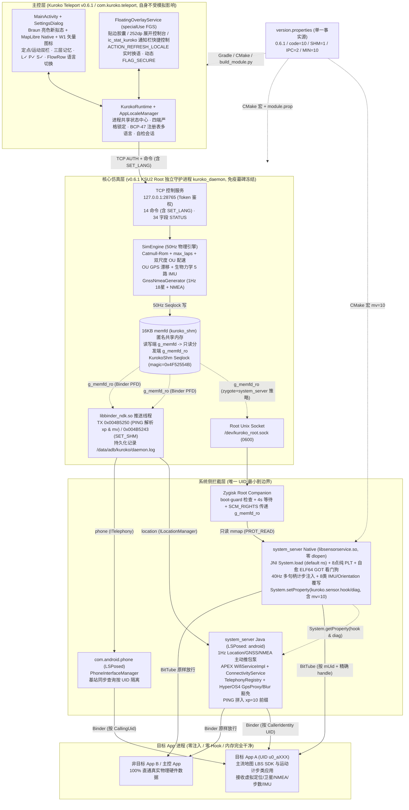
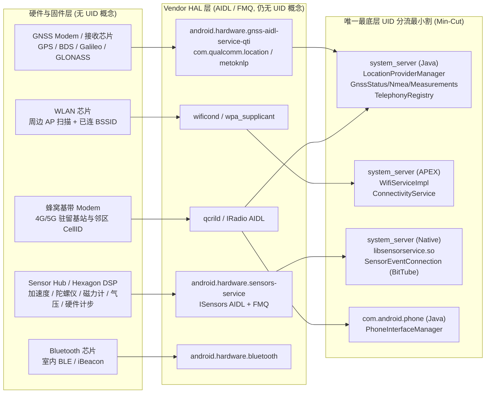
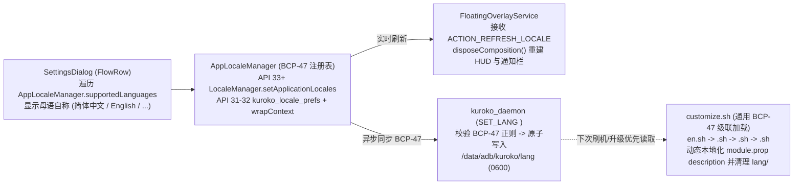
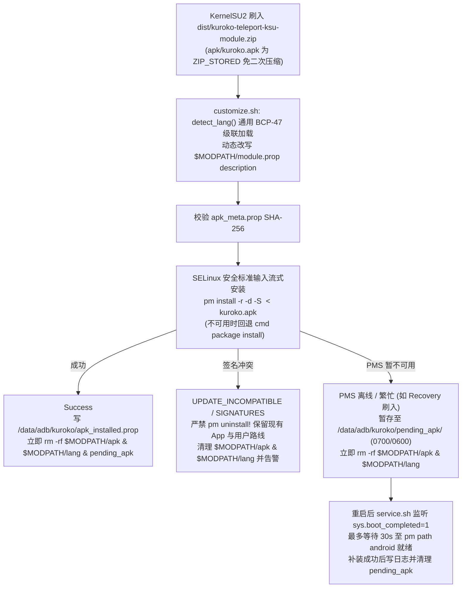

# Kuroko Teleport 深度技术架构文档

本文档详述 **Kuroko Teleport** 在 **Android 17 (API 37) / HyperOS 4** 平台上的系统架构设计、底层二进制拦截依据、跨进程共享内存与 Binder NDK 协议、四端严格版本锁定体系、All-in-One 模块生命周期、数据驱动可扩展多语言架构及生物力学物理仿真模型。所有 ELF 偏移、符号名、Java 类名、方法签名、SELinux 策略与双命名空间实战修正均经真机实测验证，并与仓库源码（**Kuroko Teleport `v0.6.1` (`versionCode=10`, `IPC=2`, `SHM=1`) All-in-One 基线**）1:1 对齐。

---

## 1. 全链路系统架构总览

Kuroko Teleport 采用 **“单一版本契约 (`version.properties`) + 单写者 Native 物理引擎 + 16KB 无锁共享内存 + 系统侧双引擎消费”** 的解耦架构，并通过 All-in-One KSU2 模块（`id=kuroko_teleport` / `name=Kuroko Teleport`，产物 `dist/kuroko-teleport-ksu-module.zip`）实现单包同步分发与全链路多语言支持：

- **控制层 (`com.kuroko.teleport` v0.6.1 / code=10)**：基于 Jetpack Compose + MapLibre Native `11.12.2` 的 Braun 亮色新拟态主控 App（配 W1 极简空间折裂矢量 Adaptive/Monochrome 图标与 `ic_stat_kuroko.xml` 状态栏图标），经进程级共享状态中心 `KurokoRuntime` 统筹 `MainActivity`、`FloatingOverlayService`（Android 14–17 `specialUse` 前台保活、`kuroko_hud_channel`）、数据驱动多语言管理器 `AppLocaleManager`（`kuroko_locale_prefs`）、内置「计步 / IMU 传感器自检」会话以及**四端严格版本锁定状态机 (`VersionCompatState`)**，通过 `127.0.0.1:28765`（Token 鉴权，`KurokoProtocol`）向守护进程下发 WGS-84 轨迹、运动参数与语言偏好 (`SET_LANG`)。
- **物理仿真与状态源 (`kuroko_daemon` v0.6.1 / code=10)**：KSU2 `post-fs-data.sh` 拉起的独立 C++20 Root 守护进程（不受 Android App 墓碑与省电冻结影响），以 **50Hz (20ms)** 节拍推进轨迹运动学、双时间尺度 OU 配速波动、OU 有色 GPS 抖动与生物力学 5 路 IMU，以 **1Hz** 刷新多星座 GNSS 与 NMEA，通过 Seqlock 原子写入 16KB 匿名 `memfd`（`"kuroko_shm"`）；并对外通过 `/proc/self/fd/<g_memfd>` 以 `O_RDONLY` 重新打开只读句柄 `g_memfd_ro` 进行跨进程分发。
- **系统侧消费层（目标 App 零注入）**：
  - **Native 传感器引擎（Zygisk Next `kuroko_zygisk` `v0.6.1` / code=10）**：仅注入 `system_server`（零 C `dlopen` 导入），主路径通过 JNI `java.lang.System.load` 在 `default` linker namespace 加载唯一一份 `libsensorservice.so` 并执行 **8 点纯 PLT/GOT Hook**（5 核心 + 3 层多句柄发现，已过滤 `arg4=-1` 哨兵），辅以 `StepInjectorThread` 内置纯 C++ ARM64 ELF64 `.rela.plt` GOT 自愈看门狗；同时在 `kuroko.sensor.hook` 与 `<=1Hz` 实时遥测 `kuroko.sensor.diag` 中携带自身模块版本号 `mv=10`。
  - **Java 定位/环境引擎（LSPosed `KurokoXposedEntry` `v0.6.1` / code=10）**：仅注入 `system_server` (`android`) 与 `com.android.phone`，以 1Hz 主动推包泵接管定位/GNSS/NMEA，按 UID 隔离 APEX Wi-Fi 双通道、双进程蜂窝基站及 HyperOS 4 代理/模糊定位服务，并在 `PING` 事务第 3 段 UTF-8 字节数组中前置拼入 `xp=${BuildConfig.VERSION_CODE}`（`xp=10`）回传给守护进程。

---

## 2. 硬件 / HAL 5 管道与“UID 边界铁律”

### 2.1 定位数据并非都来自“传感器”

在现代 Android SoC（如高通 `qti` ARM64 平台 Android 17 测试设备）中，App 用来判定地理位置与运动真实性的数据源自 **5 条彼此独立的硬件与 Vendor HAL 管道**（外加网络 IP 通道）：

### 2.2 为什么绝不能下沉到 Vendor HAL 或 Linux 内核层？

1. **HAL 与内核层不存在调用方身份（UID 边界铁律）**：`ISensors` HAL 仅向共享 FMQ 推送原始物理采样，`IGnss` HAL 仅向 `system_server` 上报定位结果，底层驱动既无 `UID` 也无 `PackageName`。在 HAL 或内核伪造必然造成**全局污染**，无法实现单应用隔离，且主控 App 自身也无法读取真实定位。
2. **篡改底层无线 HAL 会破坏正常通信**：`wificond` 与 `qcrild` 同时承载 Wi-Fi 关联、路由转发与 4G/5G 驻网通话，只能在系统服务向客户端 App 序列化汇报的瞬间按 UID 脱敏，绝不能污染通信链路本身。

因此，**`system_server`（Java + Mainline APEX + Native `libsensorservice.so`）与 `com.android.phone`** 构成了同时满足“最底层必经总闸（统一涵盖 Java API、NDK `ASensorManager`、Flutter、Unity 与加固 SDK）”与“精确感知调用方 UID”的**数学唯一最小割**。

---

## 3. `system_server` 单命名空间纯 PLT/GOT + 自愈 ELF64 GOT 传感器引擎

### 3.1 Android 17 / ARM64 安全基线与纯 PLT/GOT 突破

对真机 `/system/lib64/libsensorservice.so` 的只读 ELF 与 ARM64 反汇编分析实测如下：
- **架构与页对齐**：纯 64 位 `arm64-v8a`，`PT_LOAD p_align = 0x4000`（16KB 页大小）。
- **指令流完整性保护**：`PT_GNU_PROPERTY = 0x3`（**ARM64 BTI + PAC 全开**），函数序言普遍包含 `paciasp` / `bti c`。在此环境下实施传统 Inline Hook 极易触发 `SIGILL` / `SIGSEGV` 或签名认证失败导致 `system_server` 崩溃重启。
- **关键突破**：`libsensorservice.so` 编译时**未启用 `-Bsymbolic`**，其核心内部调用全部经过 `.rela.plt`（`R_AARCH64_JUMP_SLOT`）/ GOT 表。改写 GOT 表项即可实现 **100% 零汇编改写、全兼容 BTI/PAC 的高稳定劫持**。

### 3.2 消除 Zygisk 隔离 Linker Namespace 双副本陷阱

> **真机 `/proc/$(pidof system_server)/maps` 实锤复盘**：
> 在 Android 17 / HyperOS 4 上，Zygisk Next 将模块 `arm64-v8a.so` 加载在**隔离的 linker namespace** 中。此前 `v0.3.0` 在 `postServerSpecialize` 中直接调用 C `dlopen("/system/lib64/libsensorservice.so", RTLD_NOW | RTLD_GLOBAL)`，导致 bionic 在 Zygisk 隔离命名空间加载了一份**永远不会被系统调用的死副本**（被 `lsplt` 挂上全部 8 个钩子却零命中）；而随后 `SystemServer` 调用 `System.loadLibrary("android_servers")` 时，又在 `default` 命名空间加载了**第二份真正干活的 `libsensorservice.so`**（`GNU_RELRO` 保持 `r--p` 零钩子），致使 8 个钩子从未被触发！

自 `v0.3.1` 起通过 **“零 C `dlopen` + JNI `default` 命名空间主路径 + 自愈 ELF64 GOT 看门狗”** 双保险彻底根除该问题（对应源码：`native/zygisk/sensor_hook.{h,cpp}`、`native/zygisk/module.cpp`）：

1. **彻底移除 C `dlopen`**：编译后审计确认 `zygisk/arm64-v8a.so` 的 `.dynsym` 中 **零 `dlopen`/`dlsym`/`dlerror`/`dlclose` 导入符号**，绝不再向 Zygisk 隔离命名空间引入副本。
2. **主路径（`jni_plt`）**：
   - 在 `install_sensor_hooks(api, env, shm, out_status)` 中缓存 `JavaVM* g_jvm`，通过 `JNIEnv` 直接调用 **`java.lang.System.load("/system/lib64/libsensorservice.so")`**（由 `libnativeloader` 加载至 `system_server` 的 `default` 命名空间，与后续 `System.loadLibrary("android_servers")` 复用**唯一一份**内存实例；全程异常捕获、日志记录并 `ExceptionClear()`，绝不向 ART 抛异常）。
   - 扫描 `/proc/self/maps` 严格匹配 `offset == 0 && perms[0] == 'r' && perms[3] == 'p'`（仅私有映射 `r--p`，自动避开 `lsplt` 生成的 `r--s` 共享备份与 `---p` 占位页）且路径匹配 `/libsensorservice.so` 的 `(base, dev, ino)`，调用 `api->pltHookRegister` + `api->pltHookCommit()` 挂上全部 8 个符号，记录 `base` 至 `g_patched_bases`，返回 `ok:jni_plt:mv=10,core=%d/5,disc=%d/3`。
3. **自愈兜底路径（纯 C++ ARM64 ELF64 `.rela.plt` GOT 看门狗）**：
   - `module.cpp` 在 `shm_ != nullptr` 时**绝不调用 `DLCLOSE_MODULE_LIBRARY`**，保证 `StepInjectorThread` 持续驻留。
   - `StepInjectorThread` 按动态频率（开机前 30 秒：未挂钩时每 `50ms`、已挂钩时每 `500ms`；30 秒后每 `5s`）持续扫描 `/proc/self/maps` 中的 `r--p offset=0` `/libsensorservice.so` 基址数 `mp`。一旦检测到任何未在 `g_patched_bases` 中的新基址 `base`，立即执行 `patch_elf_got_at_base(base)`：
     - 校验 ELF64 魔数（`\x7fELF`、`ELFCLASS64`、`EM_AARCH64`），解析 `PT_LOAD` 计算 `load_bias`，解析 `PT_DYNAMIC` 提取 `DT_SYMTAB`、`DT_STRTAB`、`DT_STRSZ`（强校验 `strsz > 0` 且 `strtab[strsz - 1] == '\0'`）、`DT_JMPREL`、`DT_PLTRELSZ`（兼容 bionic 已重定位/未重定位两种 `d_ptr` 语义：`d_ptr >= base ? d_ptr : load_bias + d_ptr`）。
     - 遍历 `R_AARCH64_JUMP_SLOT (1026)` 匹配全部 8 个符号；修补前校验 `slot` 处于可读私有 VMA，并对 `old_val` 做**重定位完成守卫**：若 `old_val == spec.hook_fn` 则跳过；若 `!old_val` 或 `old_val` **未指向 `PROT_EXEC` 可执行 VMA**，则置 `had_unresolved_slot = true` 延后至下一 tick 重试，彻底杜绝半重定位解引用引发 `system_server` `SIGSEGV`！
     - 使用 `sysconf(_SC_PAGESIZE)`（兼容 4KB/16KB 页大小，支持跨页槽位）对目标页 `mprotect(orig_prot | PROT_WRITE)` -> 先原子存入对应 `std::atomic` `g_orig_*` -> `__atomic_store_n(slot, spec.hook_fn, __ATOMIC_RELEASE)` -> 恢复原始 `orig_prot`。
     - 修补成功后登记 `g_patched_bases` 并通过 JNI 更新 `kuroko.sensor.hook = "ok:got:mv=10,core=%d/5,disc=%d/3,maps=%d"`。
   - 全部 8 个 `g_orig_*` 函数指针均为 `std::atomic`（`memory_order_acquire` 读取并判空），无并发竞态。

### 3.3 8 点纯 PLT/GOT 符号表与三层多句柄发现机制（含哨兵过滤）

| 分组 | C++ Mangled 符号名（`R_AARCH64_JUMP_SLOT`） | 劫持职责与寄存器/ABI 实锤 |
| :--- | :--- | :--- |
| **核心 1/5** | `_ZN7android13SensorService21SensorEventConnectionC1ERKNS_2spIS0_EEjiNS_7String8EbRKNS_8String16ES9_` | 连接建立时直接捕获 `x0=this (conn_ptr)`、`w2=uid`，建立 `g_conns[conn_ptr] -> ConnRecord{uid}`，**零结构体偏移硬编码**。 |
| **核心 2/5** | `_ZN7android13SensorService21SensorEventConnection9addSensorEi` | 记录连接激活的传感器 `handle` 集合 `active_handles`；若新增句柄或为 `STEP_COUNTER` 则立即置位 `need_initial_emit=true`（确保复跑复用连接也能立刻收到首包）。 |
| **核心 3/5** | `_ZN7android13SensorService21SensorEventConnection12removeSensorEi` | 传感器注销时同步移除 `handle`。 |
| **核心 4/5** | `_ZN7android13SensorService21SensorEventConnection10sendEventsEPK15sensors_event_tmPS2_PKNS_2wpIKS1_EE` | 传感器事件派发总闸。实测 `sizeof(sensors_event_t) == 0x68` (104B)，内部持有 `mConnectionLock`（`this+0x40`）与 `mChannel`（`this+0x30`）。既用于按 UID 栈拷贝覆写连续传感器，也作为计步注入线程的安全原函数入口。 |
| **核心 5/5** | `_ZN7android13SensorService17cleanupConnectionEPNS0_21SensorEventConnectionE` | 获取 `std::unique_lock<std::shared_mutex>` 排他锁后从 `g_conns` 移除记录再调原函数，严格消除注入线程的悬垂指针 / UAF 风险（锁序严格遵循 `mLock -> g_state_mu -> mConnectionLock` 无死锁）。 |
| **发现 1/3 (一级 AOSP)** | `_ZN7android17SensorServiceUtil10SensorList3addEiNSt3__110shared_ptrINS_15SensorInterfaceEEEbbi` | 开机注册全部硬件/虚拟传感器（92+ 个，含 Non-wakeup 与 Wakeup）时，记录 `thread_local int32_t tls_pending_reg_handle = handle`（失败则复位 `-1`）。 |
| **发现 2/3 (一级 AOSP)** | `_ZN7android17SensorServiceUtil17RecentEventLoggerC1Ei` | 紧随 `SensorList::add` 构造时传入 `sensor_type`，消费 `tls_pending_reg_handle` 完成全量 `g_handle_to_type[handle] = sensor_type` 精确配对。 |
| **发现 3/3 (二级 HyperOS)** | `_ZN19MiSensorServiceStub19SaveSensorUsageItemEiRKN7android7String8ES3_bii` | HyperOS 传感器 `enable` 时吐出 `(type, ..., arg4, handle)` 作为二级兜底；强校验 `arg4 >= 0 && handle >= 0 && type > 0`，彻底过滤 `SensorDevice::doActivateHardwareLocked` 传入的 `(arg4=-1, w5=1)` 哨兵污染；另有 `hook_send_events` 三级被动兜底 `ensure_handle_recorded`。 |

**`SensorsEvent`（104 字节）内存布局校验**（静态断言 `sizeof(SensorsEvent) == 0x68`）：`+0x00 version(104)`、`+0x04 sensor(handle)`、`+0x08 type`、`+0x10 timestamp(CLOCK_BOOTTIME ns)`、`+0x18 data[16]/u64_data[8]`、`+0x58 flags`。

### 3.4 零全局污染栈拷贝、8 类 IMU/罗盘覆写、40Hz 多句柄注入与 `mv=10` 遥测

1. **禁止原地改写共享缓冲**：`hook_send_events` 对命中目标 UID 的连接在栈缓冲 `SensorsEvent stack_copy[64]`（超 64 条退避至 `std::vector`）中拷贝修改；开启 `KUROKO_POLICY_STEPS` 屏蔽真实硬件步数事件，开启 `KUROKO_POLICY_IMU` 覆写 8 类连续传感器（`ACCELEROMETER(1)`、`MAGNETIC_FIELD(2)`、`ORIENTATION(3)`、`GYROSCOPE(4)`、`PRESSURE(6)`、`GRAVITY(9)`、`LINEAR_ACCELERATION(10)`、`ROTATION_VECTOR(11)`/`GAME_ROTATION_VECTOR(15)`）。
2. **40Hz 多句柄主动计步注入泵**：收集每连接实际订阅的全部 `type==18` 与 `type==19` 句柄（兼容 Non-wakeup/Wakeup 双句柄，缓冲 `batch[16]`），首次初始化保底 `step_counter_base >= 1000`，首次订阅与复跑 `addSensor` 立刻发 `ON_CHANGE` 首包，严格按增量累加 `emitted_steps` 保单调不倒退。
3. **实时运行时遥测（`kuroko.sensor.diag`）**：`StepInjectorThread` 通过 `AttachCurrentThreadAsDaemon` 按 `<= 1Hz` 限频更新 `mv=10,m=...,mp=...,c=...,d=...,sh=...,c1=...,ad=...,se=...,ok=...,er=...,u=...,h=...,v=...,r=...`。

---

## 4. 16KB Seqlock `memfd` 共享内存、四端严格版本锁定与控制协议

### 4.1 16KB 页对齐 `KurokoShm` 内存布局

权威定义位于 `common/include/kuroko_shm.h`（`#pragma pack(push, 1)`，编译期 `static_assert` 锁定 `sizeof(KurokoShm) == 16384`）：

| 偏移范围 | 大小 | 分区名称 | 核心字段说明 |
| :--- | :--- | :--- | :--- |
| `0x000 .. 0x03F` | 64 B | **Header** | `magic` (`0x4F52554B` `"KURO"`), `version` (`1`), `seq` (Seqlock), `active`, `target_count` (`0..32`), `motion_mode`, `carry_mode`, `global_flags`, `daemon_heartbeat_ns`, `snapshot_boot_ns`, `snapshot_utc_ms`, `route_epoch` |
| `0x040 .. 0x0BF` | 128 B | **Location Snapshot** | `lat_wgs84`, `lon_wgs84`, `alt_wgs84`, `msl_alt`, `speed_mps`, `bearing_deg`, `h_accuracy_m`, `v_accuracy_m`, `speed_accuracy_mps`, `bearing_accuracy_deg`, `total_distance_m`, `route_progress`, `lap_count`, `sv_count`, `jitter_sigma_m`, `target_speed_mps` |
| `0x0C0 .. 0x13F` | 128 B | **Biomechanics / IMU** | `virtual_step_count`, `last_step_boot_ns`, `cadence_spm`, `stride_length_m`, `gait_phase_rad`, `pressure_hpa`, `accel[3]`, `linear_accel[3]`, `gravity[3]`, `gyro[3]`, `rot_vec[4]`, `mag[3]` |
| `0x140 .. 0x33F` | 512 B | **Target UID Table** | `KurokoTarget targets[32]`，每项 16 B：`uid (4B)` + `policy_flags (4B)` + `step_baseline_override (8B)` |
| `0x340 .. 0x93F` | 1536 B | **Synthetic GNSS SVs** | `KurokoSv svs[32]`，每项 48 B：`constellation`, `svid`, `cn0_dbhz`, `elevation_deg`, `azimuth_deg`, `carrier_freq_hz`, `baseband_cn0_dbhz`, `flags` |
| `0x940 .. 0x113F` | 2048 B | **Synthetic NMEA Epoch** | `nmea_seq (4B)`, `nmea_len (4B)`, `nmea_text[2040]` |
| `0x1140 .. 0x3FFF` | 11968 B | **16KB Page Pad** | 填充至精确 16384 字节，契合 ARM64 16KB 内核页粒度 |

**单应用策略位掩码（`policy_flags`）**：`LOCATION (bit 0)`、`STEPS (bit 1)`、`IMU (bit 2)`、`HIDE_WIFI (bit 3)`、`HIDE_CELL (bit 4)`、`SUPPRESS_MEAS (bit 5)`；预设 **跨城严防 `0x3F`**（`KUROKO_POLICY_ALL_STRICT`） / **同城户外 `0x2F`**（`KUROKO_POLICY_LOCAL_OUTDOOR`）。

### 4.2 Seqlock 无锁一致性、只读 `g_memfd_ro` 与四端版本回传

- **Seqlock + 5 秒心跳熔断**：单写者奇数开始/偶数提交 + release 屏障，读者最多 8 次 acquire 重试并校验 `magic == 0x4F52554B`（`"KURO"`）、`version == 1` 与 `CLOCK_BOOTTIME - daemon_heartbeat_ns <= 5s`。
- **只读 `g_memfd_ro` + `zygote` SELinux 三域策略**：通过 `open("/proc/self/fd/<g_memfd>", O_RDONLY | O_CLOEXEC)` 获取只读句柄消除内核 `security_binder_transfer_file` 的 `{ write }` 拦截；`sepolicy.rule` 同时覆盖 `zygote`、`system_server`、`radio` 三域。
- **Binder NDK 合法事务码与三段 `PING` 协议**：`KUROKO_BINDER_TX_SET_SHM = 0x004B5243`（`'KRC'`）、`KUROKO_BINDER_TX_PING = 0x004B5250`（`'KRP'`）、`KUROKO_ACK_OK = 0x4F4B`（先 `AIBinder_Class_define` + `AIBinder_associateClass`，`AParcel_writeParcelFileDescriptor` 对应 Java `readTypedObject(ParcelFileDescriptor.CREATOR)`）。`ILocationManager` `PING` 回复保留 2 个 int（`mapped`, `sensorOk`）并在第 3 段 UTF-8 `byte[]`（`<= 256` 字节）前置拼入 `xp=10`，由守护进程 `parse_kv_int32` 提取 `g_xposed_code` (`xp`) 与 `g_zygisk_code` (`mv`)。

### 4.3 统一版本契约与四端严格版本锁定状态机

- **单一事实源（`version.properties`）**：`RELEASE_VERSION_NAME=0.6.1`、`RELEASE_VERSION_CODE=10`、`SHM_SCHEMA_VERSION=1`、`IPC_PROTOCOL_VERSION=2`、`MIN_COMPAT_MODULE_CODE=10`、`MIN_COMPAT_APP_CODE=10`，同步驱动 CMake（`CMAKE_CONFIGURE_DEPENDS`）、Gradle、`module.prop` 与 `build_module.py`。
- **严格锁定判定（`VersionCompatState`）**：仅当 `modCode == APP_VERSION_CODE && modVer == APP_VERSION_NAME && protoVer == IPC_PROTOCOL_VERSION && shmVer == SHM_SCHEMA_VERSION && (!locShm || xposedCode == APP_VERSION_CODE) && (!sensorShm || zygiskCode == APP_VERSION_CODE)` 全部满足时才为 `MATCHED`（`canStartSimulation = true`）；仅已加载系统 Hook 滞后于已对齐的 Daemon 时判为 `REBOOT_REQUIRED`；其余不匹配判为 `MISMATCH_LOCKED`。全链路拦截启动/继续/定点/自检发步，永远放行停止/暂停/重连/设置/路线。

### 4.4 本地 TCP 控制平面（`127.0.0.1:28765`，14 命令 / 34 字段 `STATUS`）

首行强制 `AUTH <128-bit hex token>`（`/data/adb/kuroko/token` `0600`），支持以下 14 条命令：

| 命令 | 参数格式 | 功能 |
| :--- | :--- | :--- |
| `PING` | 无 | 存活探活（返回 `OK PONG`） |
| `STATUS` | 无 | 返回 34 字段 JSON（缓冲 `2048 B`：坐标/速度/步态/目标/3路SHM/`sensor_diag` + 7 项四端版本/协议字段） |
| `START` / `HOLD` / `STOP` | 无 | 启动运动 / 原地驻留（配合显式非静止 `mode` 可原地发步） / 停止恢复真机 |
| `RESET_STEPS` | 无 | 重置虚拟步数、累计里程与圈数（Native 注入端保持 `emitted_steps` 单调递增） |
| `SET_POINT` | `<lat> <lon> [alt]` | 设置单点静止虚拟坐标（WGS-84，重置 `max_laps=0`） |
| `SET_ROUTE` | 4 参：`<loop 0\|1> <max_dist_m> <max_laps 0\|N> <lat,lon,alt;...>` （兼容 3 参） | 下发路线航点序列、循环标志、目标里程与重复圈数上限 |
| `SET_SPEED` | `<speed_mps>` | 设置目标平均速度（`0.0 ~ 30.0 m/s`） |
| `SET_PACE_VAR` | `<ratio>` | 设置双时间尺度跑步配速波动系数（`0.0 ~ 0.25`，默认 `0.08`） |
| `SET_MODE` | `<motion_mode 0..5> [carry_mode 0\|1]` | 设置步态模式与携带姿态（手持摆臂/裤兜） |
| `SET_JITTER` | `<sigma_m>` | 设置 OU GPS 抖动标准差（`0.0 ~ 25.0 m`） |
| `SET_TARGETS` | `NONE` 或 `<uid:policy_mask,...>` | 下发最多 32 个目标 UID 及其策略位掩码 |
| `SET_LANG` | `<auto\|BCP-47>`（正则 `^[a-zA-Z]{2,3}(-[a-zA-Z0-9]{2,8}){0,2}$`, `<=16`） | **`v0.6.0` 新增**：`auto` 删除 `/data/adb/kuroko/lang`，合法 BCP-47 原子写入 `0600` 文件供 `customize.sh` 刷机/升级读取 |

---

## 5. 数据驱动可扩展多语言架构

为彻底避免将逻辑写死在中/英两语，Kuroko Teleport 在 **App UI、后台悬浮窗、守护进程、KSU2 安装器与构建脚本** 5 层统一采用数据驱动设计：

1. **Android 资源分层（437 组严格对称键）**：
   - `values/strings.xml`（246 键，英文默认基准，含 `xposed_description`）与 `values/strings_modules.xml`（191 键，覆盖地图/地理编码/路线/预设/点位/目标应用/帮助/悬浮窗/通知栏）与 `values-zh/` 100% 键集与位置占位符（`%1$s` / `%2$d` / `%%`）对称。
   - `res/xml/locales_config.xml` 声明 Android 13+ 原生系统 Per-App Language 列表；`RouteStore` 通过 `CustomSpeedPreset.builtInKey`（`walk`/`jog`/`run`/`sprint`）本地化渲染内置预设名；`GeocoderClient` 使用 `KurokoTeleport/<version>` User-Agent 并动态按当前 BCP-47 构造 Nominatim `accept-language`。
2. **注册表驱动 `AppLocaleManager.kt`**：
   - 维护单一声明列表 `SUPPORTED_LANGUAGES: List<SupportedLanguage>`，所有具体语种采用**母语自称（Endonym）**，确保用户永不会因误切陌生语种而迷路。
   - 全部 Kotlin 业务代码中 **零 `if (lang == "zh")` 硬编码分支**、**零面向用户的硬编码中文字符串**。
3. **KSU2 安装器通用 BCP-47 级联加载（`customize.sh` + `build_module.py`）**：
   - `detect_lang()` 依次探测 `/data/adb/kuroko/lang` -> `persist.sys.locale` -> `ro.product.locale` -> `persist.sys.language` -> `ro.product.locale.language` -> `settings get system system_locales`。
   - 归一化后始终先加载 `lang/en.sh` 作为全量兜底，随后按存在性依次覆盖加载 `lang/<primary>.sh` -> `lang/<primary>-<script_region>.sh`（`Hans`->`CN`、`Hant`->`TW`）-> `lang/<primary>-<REGION>.sh`，并安全逐行改写 `$MODPATH/module.prop` 的 `description=$MOD_DESC`（零 `sed` 分隔符转义风险）；`build_module.py` 动态扫描 `module_template/lang/*.sh` 自动做 BCP-47 文件名、LF 与 key/占位符一致性审计。
4. **如何新增语言（3 步扩展规范）**：
   - **步骤 1**：新增 `app/src/main/res/values-<android_bcp47>/strings.xml` 与 `strings_modules.xml`（对齐 437 个键与占位符）。
   - **步骤 2**：在 `app/src/main/res/xml/locales_config.xml` 追加 `<locale android:name="<tag>" />`，并在 `AppLocaleManager.kt` 的 `SUPPORTED_LANGUAGES` 追加 `SupportedLanguage("<tag>", "<母语自称>")`。
   - **步骤 3（可选）**：在 `module_template/lang/` 放入 `<tag>.sh`（对齐 `en.sh` 16 个变量、严格 LF 换行），重新运行 `gradlew :app:assembleDebug` + `python build_module.py` 即可零代码修改全链路生效。

---

## 6. All-in-One 模块生命周期与 W1 矢量图标体系

对应源码：`build_module.py`、`module_template/{module.prop, customize.sh, service.sh, uninstall.sh}`、`app/src/main/res/{drawable,mipmap-*}/`

- **策略 A1**：保持统一签名证书配置（不破坏本地既有签名密钥），支持无缝覆盖继承路线与 LSPosed 作用域。
- **策略 A2**：签名冲突与 `uninstall.sh` **绝不调用 `pm uninstall`**，完整保护用户路线资产；`uninstall.sh` 仅停止守护进程并清理 `/dev/kuroko_root.sock` 与 `/data/adb/kuroko`。
- **策略 A4**：安装完成即刻删除 `$MODPATH/apk/` 与 `$MODPATH/lang/`，零长期占用 KernelSU `modules.img`。
- **W1 极简空间折裂矢量图标体系（`v0.6.1`）**：纯白 `#FFFFFF` 底 + 暖玫瑰陶土 `#C48077` 折裂定位针（`evenOdd` 镂空圆心 + ~25° 对角切片微距错位），完整覆盖 Android 13–17 Adaptive + Monochrome（`ic_launcher_{background,foreground,monochrome}.xml` + `mipmap-anydpi-v26`）、前台通知栏 `24dp` 矢量图标 `ic_stat_kuroko.xml`（接入 `FloatingOverlayService`）及 5 档传统 PNG 兼容图标。

---

## 7. Android 17 APEX `ClassLoader` 与 HyperOS 4 专项适配

- **1Hz 定位/卫星/NMEA 主动推包泵（`LocationHook.kt`）**：全 Provider（`gps`/`network`/`fused`/`passive`）拦截 + 遍历 `ListenerMultiplexer.mRegistrations` 按 `CallerIdentity.uid` 主动投递无 Mock 标志 `LocationResult`、18 星 `GnssStatus` 与 NMEA 电文，并抑制冲突 `GnssMeasurementsEvent`。
- **APEX 双通道 Wi-Fi 隔离（`WifiConnectivityHook.kt`）**：动态捕获 `service-wifi.jar` 与 `service-connectivity.jar` 独立 `ClassLoader`；`WifiServiceImpl.getScanResults` 反射构造 jarjar 重定位类 `com.android.wifi.x.com.android.modules.utils.ParceledListSlice` 空列表；`android.net.connectivity.com.android.server.ConnectivityService.createWithSensitiveInfoSanitizedIfNecessaryWhenParceled` 强制 `includeLocationInfo=false` 一次性清洗同步与 `NetworkCallback` 双通道 `WifiInfo`。
- **双进程蜂窝基站与 HyperOS 4 豁免（`TelephonyHook.kt` & `HyperOsHook.kt`）**：`com.android.phone` (`PhoneInterfaceManager`) + `system_server` (`TelephonyRegistry`) 按 `KUROKO_POLICY_HIDE_CELL` 双档策略隔离；豁免 HyperOS 4 `GpsProxyManager`（防墓碑静止冻结）与 `MiuiBlurLocationManagerImpl`（防模糊定位二次加噪）。

---

## 8. 50Hz 轨迹、双尺度配速、OU 噪声与同源生物力学 IMU 模型

对应源码：`native/daemon/sim_engine.cpp`、`native/daemon/nmea_gnss.cpp`

1. **Catmull-Rom 样条、弯道减速与双尺度配速**：每段约 $3\text{ m}$ 密采样（$\text{clamp}(\lceil d / 3.0 \rceil, 4, 40)$），支持闭合循环、目标里程与 `max_laps`；弯道减速 $c_f = 1 - \text{clamp}(\Delta\psi / 120^\circ, 0, 0.30)$；双尺度 OU 配速波动（中期 $\tau=18\text{s}$ $\sigma=0.75r$ + 短期 $\tau=4\text{s}$ $\sigma=0.35r$，限幅 $[\max(0.65, 1-1.6r), 1+1.6r]$）经 $\tau_a=1.2\text{s}$ 惯性平滑。
2. **OU 有色噪声 GPS 漂移**：局部 ENU 平面 $\tau_{\text{gps}} = 9\text{s}$ 离散 OU 过程（垂直系数 `0.65`，叠加 $0.14\,\sigma$ 高频噪声），水平精度 `h_accuracy_m` 在 $3.0 \sim 18.0\text{ m}$ 相关呼吸波动（$\tau = 10\text{s}$）。
3. **同源单相位生物力学 5 路 IMU 合成器**：$L(v)=\text{clamp}(0.48+0.19v, 0.62, 1.95)\text{ m}$，$f=\text{clamp}((v/L)\eta, 1.25, 3.85)\text{ Hz}$（步间 $\pm 4.5\%$ 节拍微扰展宽 FFT 主峰）；非对称足跟着地多谐波 + 高斯冲激 + 侧向**半频 $f/2$** 左右摆动；手持 (`0.55 rad`)/裤兜 (`1.38 rad`) + $\tau=4\text{s}$ 漂移四元数 $q(t)$，解析求导得陀螺仪 $\vec{\omega}(t)$，投影严格满足 $\vec{a}_{\text{accel}} \equiv \vec{g}_{\text{body}} + \vec{a}_{\text{linear}}$，气压计随海拔同步耦合。
4. **1Hz 多星座 GNSS 与 NMEA-0183**：18 颗真实星座卫星（6 GPS + 6 北斗 + 3 Galileo + 3 GLONASS，15 颗 `USED_IN_FIX`），方位角慢漂移 + $C/N_0$ OU 过程（$\tau=12\text{s}$），同步生成带合法 XOR 校验和的 `$GNGGA`/`$GNRMC`/`$GNGSA`/`$GPGSV`。
