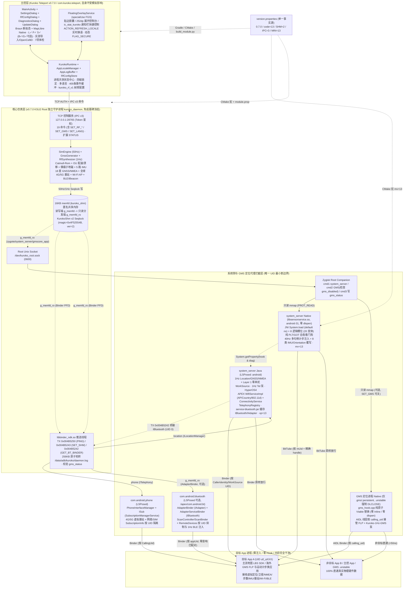
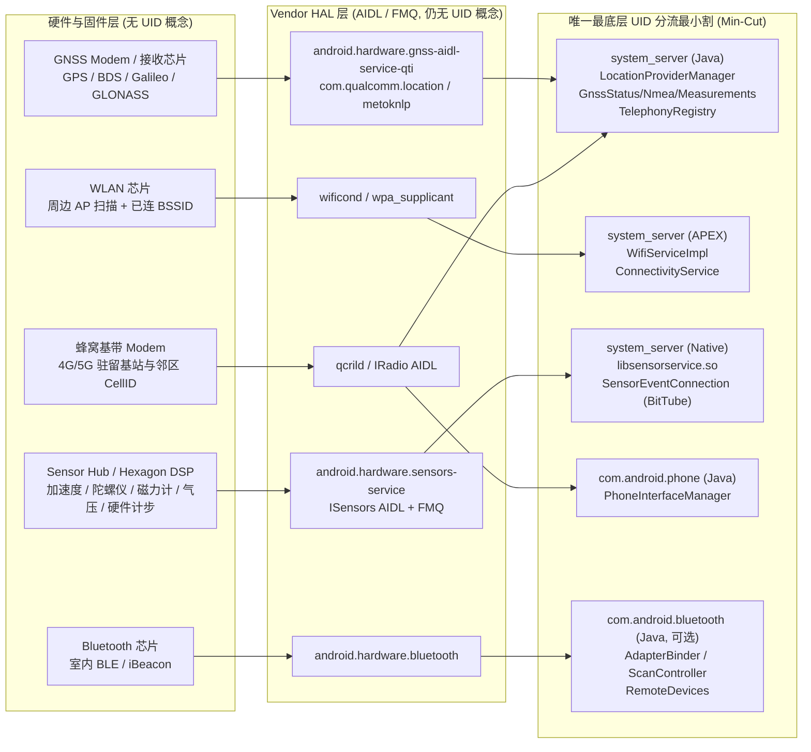
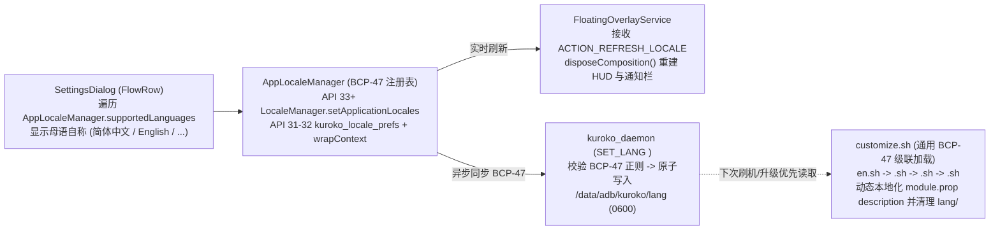
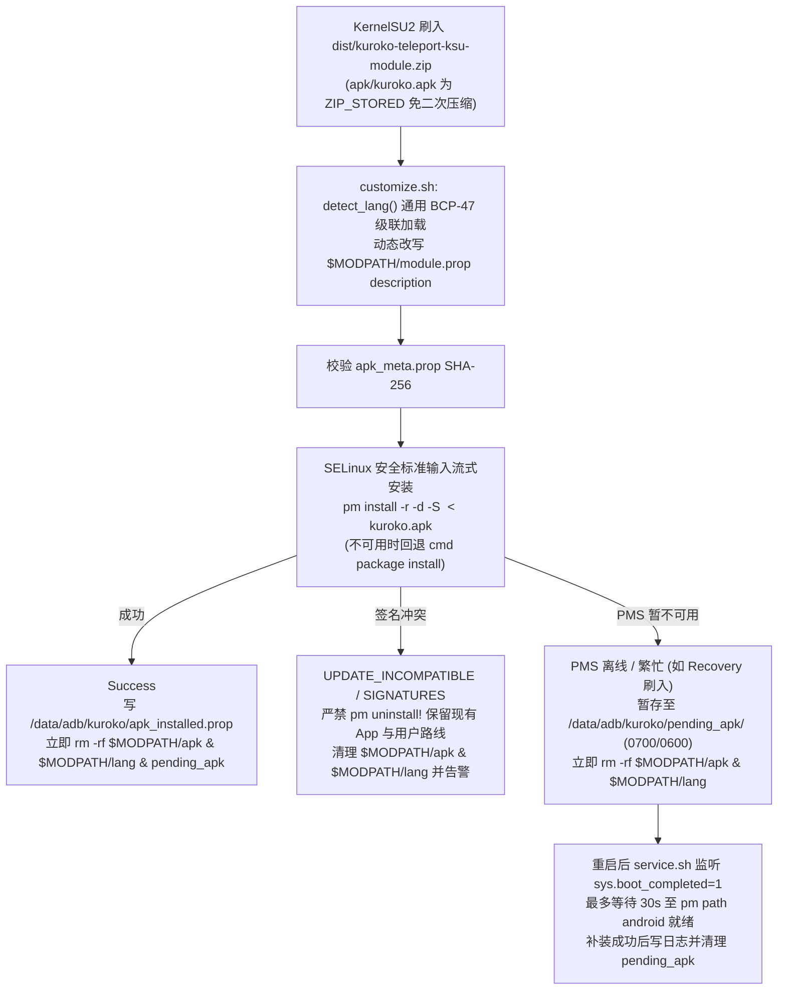

# Kuroko Teleport 深度技术架构文档

本文档详述 **Kuroko Teleport** 在 **Android 17 (API 37) / HyperOS 4** 平台上的系统架构设计、底层二进制拦截依据、跨进程共享内存与 Binder NDK 协议、四端严格版本锁定体系、All-in-One 模块生命周期、数据驱动可扩展多语言架构、应用内诊断与隐私脱敏架构、全球地理感知射频仿真引擎及生物力学物理仿真模型。所有 ELF 偏移、符号名、Java 类名、方法签名、SELinux 策略与双命名空间实战修正均经真机实测验证，并与仓库源码（**Kuroko Teleport `v0.7.0` (`versionCode=13`, `IPC=3`, `SHM=2`) All-in-One 基线**）1:1 对齐。

---

## 1. 全链路系统架构总览

Kuroko Teleport 采用 **“单一版本契约 (`version.properties`) + 单写者 Native 物理与射频引擎 + 16KB 无锁共享内存 (`KurokoShm v2`) + 系统侧多进程消费”** 的解耦架构，并通过 All-in-One KSU2 模块（`id=kuroko_teleport` / `name=Kuroko Teleport`，产物 `dist/kuroko-teleport-ksu-module.zip`）实现单包同步分发、全链路多语言、Release 更新检查与离线诊断支持：

- **控制层 (`com.kuroko.teleport` v0.7.0 / code=13)**：基于 Jetpack Compose + MapLibre Native `11.12.2` 的 Braun 亮色新拟态主控 App，经进程级共享状态中心 `KurokoRuntime` 统筹 `MainActivity`、`FloatingOverlayService`（Android 14–17 `specialUse` 前台保活、`kuroko_hud_channel`）、数据驱动多语言管理器 `AppLocaleManager`（`kuroko_locale_prefs`）、全球射频配置中心（`RfConfigStore` `kuroko_rf_v1` + `RfLiveImporter` + `RfConfigDialog`）、Release 更新检查器（`UpdateChecker` + `UpdateDialog`）、按需诊断中心（`AppLogBuffer` + `DiagnosticCollector` + `DiagnosticsDialog`）、内置「计步 / IMU 传感器自检」会话以及**四端严格版本锁定状态机 (`VersionCompatState`)**，通过 `127.0.0.1:28765`（Token 鉴权，`KurokoProtocol` IPC v3）向守护进程下发 WGS-84 轨迹、运动参数、射频配置与语言偏好 (`SET_LANG`)。
- **物理与全球射频仿真源 (`kuroko_daemon` v0.7.0 / code=13)**：KSU2 `post-fs-data.sh` 拉起的独立 C++20 Root 守护进程（不受 Android App 墓碑与省电冻结影响，带 256 KB 原子轮转 `/data/adb/kuroko/daemon.log`），以 **50Hz (20ms)** 节拍推进轨迹运动学、双时间尺度 OU 配速波动、OU 有色 GPS 抖动、纬度感知偶极子地磁与生物力学 5 路 IMU，以 **1Hz** 刷新多星座 GNSS/NMEA 及全球地理感知射频快照 `RfSynthesizer`（4G/5G 基站、区域 Wi-Fi AP 列表、BLE/iBeacon 与国家码），通过 Seqlock 原子写入 16KB 匿名 `memfd`（`"kuroko_shm"`）；并对外通过 `/proc/self/fd/<g_memfd>` 以 `O_RDONLY` 重新打开只读句柄 `g_memfd_ro` 进行跨进程分发。
- **系统侧与 GMS 定位代理消费层（目标 App 零注入 · Play Integrity 安全）**：
  - **Native 传感器引擎（Zygisk Next `kuroko_zygisk` · `system_server` `v0.7.0` / code=13）**：零 C `dlopen` 导入，主路径通过 JNI `java.lang.System.load` 在 `default` linker namespace 加载唯一一份 `libsensorservice.so` 并执行 **8 逻辑槽位纯 PLT/GOT Hook**（20 条多版本候选符号，已过滤 `arg4=-1` 哨兵），辅以 `StepInjectorThread` 内置纯 C++ ARM64 ELF64 `.rela.plt` GOT 自愈看门狗；同时在 `kuroko.sensor.hook` 与 `<=1Hz` 实时遥测 `kuroko.sensor.diag` 中携带 `mv=13`。
  - **Native GMS FLP 引擎（Zygisk Next `kuroko_zygisk` · `gms_hook.{h,cpp}` 可选 Layer 2）**：严禁将 GMS 加入 LSPosed；`preAppSpecialize` 对 `com.google.android.gms.unstable`（DroidGuard / Play Integrity）、`.ui` 及全部其他应用无条件 `DLCLOSE_MODULE_LIBRARY`；仅在 `com.google.android.gms` / `com.google.android.gms.persistent` 映射只读 `g_memfd_ro`（支持 `SET_GMS 0` 随时零驻留关闭），以纯原子 Vtable 替换在 AIDL 线层按内核 `calling_uid` 接管 `FusedLocationProvider` 并提供 1Hz 室内主动推包。
  - **Java 定位/射频环境引擎（LSPosed `KurokoXposedEntry` `v0.7.0` / code=13）**：严格限定系统组件 `system_server` (`android`)、`com.android.phone` 以及可选的 `com.android.bluetooth`：以 1Hz 主动推包泵 + Layer 1 严格零串扰 `WorkSource` 归因接管定位/GNSS/NMEA，按 UID 实施三态蜂窝基站与 `ISub`、APEX Wi-Fi AP 列表与 802.11d/国家码、蓝牙/BLE 扫描抑制与 1Hz 虚拟 iBeacon 注入，及 HyperOS 4 代理/模糊定位豁免，并在 `PING` 事务第 3 段前置拼入 `xp=13` 回传给守护进程。

---

## 2. 硬件 / HAL 5 管道与“UID 边界铁律”

### 2.1 定位数据并非都来自“传感器”

在现代 Android SoC（如高通 `qti` ARM64 平台 Android 17 测试设备）中，App 用来判定地理位置与运动真实性的数据源自 **5 条彼此独立的硬件与 Vendor HAL 管道**（外加网络 IP 通道）：

### 2.2 为什么绝不能下沉到 Vendor HAL 或 Linux 内核层？

1. **HAL 与内核层不存在调用方身份（UID 边界铁律）**：`ISensors` HAL 仅向共享 FMQ 推送原始物理采样，`IGnss` HAL 仅向 `system_server` 上报定位结果，底层驱动既无 `UID` 也无 `PackageName`。在 HAL 或内核伪造必然造成**全局污染**，无法实现单应用隔离，且主控 App 自身也无法读取真实定位。
2. **篡改底层无线 HAL 会破坏正常通信**：`wificond`、`qcrild` 与蓝牙 HAL 同时承载 Wi-Fi 关联路由、4G/5G 驻网通话及已配对蓝牙耳机/手表连接，只能在系统服务向客户端 App 序列化汇报的瞬间按 UID 隔离或替换，绝不能污染通信链路本身。

因此，**`system_server`（Java + Mainline APEX + Native `libsensorservice.so`）、`com.android.phone` 及可选的 `com.android.bluetooth`** 构成了同时满足“最底层必经总闸（统一涵盖 Java API、NDK `ASensorManager`、Flutter、Unity 与加固 SDK）”与“精确感知调用方 UID”的**数学唯一最小割**。

---

## 3. `system_server` 单命名空间纯 PLT/GOT + 自愈 ELF64 GOT 传感器引擎

### 3.1 Android 17 / ARM64 安全基线与纯 PLT/GOT 突破

对真机 `/system/lib64/libsensorservice.so` 的只读 ELF 与 ARM64 反汇编分析实测如下：
- **架构与页对齐**：纯 64 位 `arm64-v8a`，`PT_LOAD p_align = 0x4000`（16KB 页大小）。
- **指令流完整性保护**：`PT_GNU_PROPERTY = 0x3`（**ARM64 BTI + PAC 全开**），函数序言普遍包含 `paciasp` / `bti c`。在此环境下实施传统 Inline Hook 极易触发 `SIGILL` / `SIGSEGV` 或签名认证失败导致 `system_server` 崩溃重启。
- **关键突破**：`libsensorservice.so` 编译时**未启用 `-Bsymbolic`**，其核心内部调用全部经过 `.rela.plt`（`R_AARCH64_JUMP_SLOT`）/ GOT 表。改写 GOT 表项即可实现 **100% 零汇编改写、全兼容 BTI/PAC 的高稳定劫持**。

### 3.2 消除 Zygisk 隔离 Linker Namespace 双副本陷阱

> **真机 `/proc/$(pidof system_server)/maps` 实锤复盘**：
> 在 Android 17 / HyperOS 4 上，Zygisk Next 将模块 `arm64-v8a.so` 加载在**隔离的 linker namespace** 中。此前 `v0.3.0` 在 `postServerSpecialize` 中直接调用 C `dlopen("/system/lib64/libsensorservice.so", RTLD_NOW | RTLD_GLOBAL)`，导致 bionic 在 Zygisk 隔离命名空间加载了一份**永远不会被系统调用的死副本**（被 `lsplt` 挂上全部 8 个钩子却零命中）；而随后 `SystemServer` 调用 `System.loadLibrary("android_servers")` 时，又在 `default` 命名空间加载了**第二份真正干活的 `libsensorservice.so`**（`GNU_RELRO` 保持 `r--p` 零钩子），致使 8 个钩子从未被触发！

自 `v0.3.1` 起通过 **“零 C `dlopen` + JNI `default` 命名空间主路径 + 自愈 ELF64 GOT 看门狗”** 双保险彻底根除该问题（对应源码：`native/zygisk/sensor_hook.{h,cpp}`、`native/zygisk/module.cpp`）：

1. **彻底移除 C `dlopen`**：编译后审计确认 `zygisk/arm64-v8a.so` 的 `.dynsym` 中 **零 `dlopen`/`dlsym`/`dlerror`/`dlclose` 导入符号**，绝不再向 Zygisk 隔离命名空间引入副本。
2. **主路径（`jni_plt`）**：
   - 在 `install_sensor_hooks(api, env, shm, out_status)` 中缓存 `JavaVM* g_jvm`，通过 `JNIEnv` 直接调用 **`java.lang.System.load("/system/lib64/libsensorservice.so")`**（由 `libnativeloader` 加载至 `system_server` 的 `default` 命名空间，与后续 `System.loadLibrary("android_servers")` 复用**唯一一份**内存实例；全程异常捕获、日志记录并 `ExceptionClear()`，绝不向 ART 抛异常）。
   - 扫描 `/proc/self/maps` 严格匹配 `offset == 0 && perms[0] == 'r' && perms[3] == 'p'`（仅私有映射 `r--p`，自动避开 `lsplt` 生成的 `r--s` 共享备份与 `---p` 占位页）且路径匹配 `/libsensorservice.so` 的 `(base, dev, ino)`；先通过 `parse_elf_plt_view()` + `scan_matched_plt_entries()` **预扫描本机 `.rela.plt`**，仅对**真实存在**的符号去重注册（每个逻辑 `HookSlot` 至多 1 条、总数 `<= 8`，绝不注册不存在的候选符号）；若未同时具备 `CONN_C1` 与 `SEND_EVENTS` 核心槽位则零注册直接安全退化为 `err:abi_unsupported`；`pltHookRegister` 绑定全局静态寿命数组 `g_plt_orig_slots[SPEC_COUNT]`，并在 `pltHookCommit()` 后**无条件**同步所有非空原函数指针至 `g_orig_*`（同时所有 20 个包装函数均经 `load_orig_for_slot()` 对 `g_plt_orig_slots` 兜底读取），记录 `base` 至 `g_patched_bases`，返回 `ok:jni_plt:mv=13,core=%d/5,disc=%d/3`。
3. **自愈兜底路径（纯 C++ ARM64 ELF64 `.rela.plt` GOT 看门狗）**：
   - `module.cpp` 在 `shm_ != nullptr` 时**绝不调用 `DLCLOSE_MODULE_LIBRARY`**，保证 `StepInjectorThread` 持续驻留。
   - `StepInjectorThread` 按动态频率（开机前 30 秒：未挂钩时每 `50ms`、已挂钩时每 `500ms`；30 秒后每 `5s`）持续扫描 `/proc/self/maps` 中的 `r--p offset=0` `/libsensorservice.so` 基址数 `mp`。一旦检测到任何未在 `g_patched_bases` 中的新基址 `base`，立即执行 `patch_elf_got_at_base(base)`：
     - 校验 ELF64 魔数（`\x7fELF`、`ELFCLASS64`、`EM_AARCH64`），解析 `PT_LOAD` 计算 `load_bias`，解析 `PT_DYNAMIC` 提取 `DT_SYMTAB`、`DT_STRTAB`、`DT_STRSZ`（强校验 `strsz > 0` 且 `strtab[strsz - 1] == '\0'`）、`DT_JMPREL`、`DT_PLTRELSZ`（兼容 bionic 已重定位/未重定位两种 `d_ptr` 语义：`d_ptr >= base ? d_ptr : load_bias + d_ptr`）。
     - 两阶段预检遍历 `R_AARCH64_JUMP_SLOT (1026)` 匹配 8 个逻辑槽位（20 条多版本候选符号）：先校验 `CONN_C1` + `SEND_EVENTS` 均存在且所有目标 `slot` 处于可读私有 VMA 并完成 `PROT_EXEC` 重定位守卫（若 `!old_val` 或未指向可执行 VMA 则置 `had_unresolved_slot = true` 延后至下一 tick 重试，若缺失核心槽位则直接标记跳过并上报 `err:abi_unsupported`，零部分改写），彻底杜绝半重定位或空原函数解引用引发 `system_server` `SIGSEGV`！
     - 使用 `sysconf(_SC_PAGESIZE)`（兼容 4KB/16KB 页大小，支持跨页槽位）对目标页 `mprotect(orig_prot | PROT_WRITE)` -> 先原子写入 `g_plt_orig_slots[spec_idx]` 与对应 `std::atomic` `g_orig_*` -> `__atomic_store_n(slot, spec.hook_fn, __ATOMIC_RELEASE)` -> 恢复原始 `orig_prot`。
     - 修补成功后登记 `g_patched_bases` 并通过 JNI 更新 `kuroko.sensor.hook = "ok:got:mv=13,core=%d/5,disc=%d/3,maps=%d"`。
   - 全部 20 个 `g_orig_*` 函数指针均为 `std::atomic`（配合 `g_plt_orig_slots[SPEC_COUNT]` 经 `memory_order_acquire` 双层读取并防递归校验），无并发竞态。

### 3.3 8 逻辑槽位纯 PLT/GOT 多版本候选符号表（Android 12–17 / `android-31`）与三层多句柄发现

- **Native 编译基线 (`android-31`)**：`native/build_native.py` 面向 **`android-31`**（Android 12+，与 App `minSdk 31` 一致）编译 `kuroko_daemon` 与 `kuroko_zygisk`，确保 ELF 零 API>31 Bionic 符号依赖。
- **ABI 安全多版本候选表（`HookSlot`）**：`sensor_hook.cpp` 将 8 个钩子按逻辑槽位分为 5 个核心槽位（`CONN_C1`、`ADD_SENSOR`、`REMOVE_SENSOR`、`SEND_EVENTS`、`CLEANUP_CONN`）与 3 个发现槽位（`SENSOR_LIST_ADD`、`RECENT_LOGGER_C1`、`MI_SAVE_USAGE`），通过位掩码 `g_matched_core_mask` / `g_matched_disc_mask` 去重统计 `popcount`（始终保持 `core=5/5`、`disc=3/3`）。为严格满足 ARM64 AAPCS64 调用约定、杜绝跨参数个数栈参截断，**每一种参数变体均拥有独立精确签名包装函数与独立 `std::atomic` 原函数指针**：
  - `CONN_C1` 覆盖 6 参（早期 AOSP 12 无 `attributionTag`）、7 参（AOSP 12–17 标准与 `const String8&` 变体）、8 参（AOSP 14+ 含 `deviceId`）及 9 参（`...S9_ib` / `...S9_ii`）全部变体，共用 `register_conn_uid(self, uid)`。
  - `SENSOR_LIST_ADD` 覆盖 4 参（早期 AOSP 12）、5 参（AOSP 12–13）与 6 参（AOSP 14–17 含 `deviceId`）变体，共用 `tls_pending_reg_handle` 注册逻辑。
- **未知 OEM 自诊断转储**：若在某未知 ROM 扫描 `.rela.plt` 后 `CONN_C1` 或 `SENSOR_LIST_ADD` 仍未命中，看门狗会对每个基址一次性输出 `LOGW`（上限 6 行）打印 `.rela.plt` 中含 `SensorEventConnectionC` / `SensorList3add` 的实际 Mangled 符号名，用户通过应用内诊断中心导出日志包即可精准定位缺失变体。

| 逻辑槽位 | 典型 C++ Mangled 符号名（`R_AARCH64_JUMP_SLOT`） | 劫持职责与寄存器/ABI 实锤 |
| :--- | :--- | :--- |
| **核心 1/5** | `_ZN7android13SensorService21SensorEventConnectionC1ERKNS_2spIS0_EEjiNS_7String8EbRKNS_8String16ES9_` | 连接建立时直接捕获 `x0=this (conn_ptr)`、`w2=uid`，建立 `g_conns[conn_ptr] -> ConnRecord{uid}`，**零结构体偏移硬编码**。 |
| **核心 2/5** | `_ZN7android13SensorService21SensorEventConnection9addSensorEi` | 记录连接激活的传感器 `handle` 集合 `active_handles`；若新增句柄或为 `STEP_COUNTER` 则立即置位 `need_initial_emit=true`（确保复跑复用连接也能立刻收到首包）。 |
| **核心 3/5** | `_ZN7android13SensorService21SensorEventConnection12removeSensorEi` | 传感器注销时同步移除 `handle`。 |
| **核心 4/5** | `_ZN7android13SensorService21SensorEventConnection10sendEventsEPK15sensors_event_tmPS2_PKNS_2wpIKS1_EE` | 传感器事件派发总闸。实测 `sizeof(sensors_event_t) == 0x68` (104B)，内部持有 `mConnectionLock`（`this+0x40`）与 `mChannel`（`this+0x30`）。既用于按 UID 栈拷贝覆写连续传感器，也作为计步注入线程的安全原函数入口。 |
| **核心 5/5** | `_ZN7android13SensorService17cleanupConnectionEPNS0_21SensorEventConnectionE` | 获取 `std::unique_lock<std::shared_mutex>` 排他锁后从 `g_conns` 移除记录再调原函数，严格消除注入线程的悬垂指针 / UAF 风险（锁序严格遵循 `mLock -> g_state_mu -> mConnectionLock` 无死锁）。 |
| **发现 1/3 (一级 AOSP)** | `_ZN7android17SensorServiceUtil10SensorList3addEiNSt3__110shared_ptrINS_15SensorInterfaceEEEbbi` | 开机注册全部硬件/虚拟传感器（92+ 个，含 Non-wakeup 与 Wakeup）时，记录 `thread_local int32_t tls_pending_reg_handle = handle`（失败则复位 `-1`）。 |
| **发现 2/3 (一级 AOSP)** | `_ZN7android17SensorServiceUtil17RecentEventLoggerC1Ei` | 紧随 `SensorList::add` 构造时传入 `sensor_type`，消费 `tls_pending_reg_handle` 完成全量 `g_handle_to_type[handle] = sensor_type` 精确配对。 |
| **发现 3/3 (二级 HyperOS)** | `_ZN19MiSensorServiceStub19SaveSensorUsageItemEiRKN7android7String8ES3_bii` | HyperOS 传感器 `enable` 时吐出 `(type, ..., arg4, handle)` 作为二级兜底；强校验 `arg4 >= 0 && handle >= 0 && type > 0`，彻底过滤 `SensorDevice::doActivateHardwareLocked` 传入的 `(arg4=-1, w5=1)` 哨兵污染；另有 `hook_send_events` 三级被动兜底 `ensure_handle_recorded`。 |

**`SensorsEvent`（104 字节）内存布局校验**（静态断言 `sizeof(SensorsEvent) == 0x68`）：`+0x00 version(104)`、`+0x04 sensor(handle)`、`+0x08 type`、`+0x10 timestamp(CLOCK_BOOTTIME ns)`、`+0x18 data[16]/u64_data[8]`、`+0x58 flags`。

### 3.4 零全局污染栈拷贝、8 类 IMU/罗盘覆写、40Hz 多句柄注入与 `mv=13` 遥测

1. **禁止原地改写共享缓冲**：`hook_send_events` 对命中目标 UID 的连接在栈缓冲 `SensorsEvent stack_copy[64]`（超 64 条退避至 `std::vector`）中拷贝修改；开启 `KUROKO_POLICY_STEPS` 屏蔽真实硬件步数事件，开启 `KUROKO_POLICY_IMU` 覆写 8 类连续传感器（`ACCELEROMETER(1)`、`MAGNETIC_FIELD(2)`、`ORIENTATION(3)`、`GYROSCOPE(4)`、`PRESSURE(6)`、`GRAVITY(9)`、`LINEAR_ACCELERATION(10)`、`ROTATION_VECTOR(11)`/`GAME_ROTATION_VECTOR(15)`）。
2. **40Hz 多句柄主动计步注入泵**：收集每连接实际订阅的全部 `type==18` 与 `type==19` 句柄（兼容 Non-wakeup/Wakeup 双句柄，缓冲 `batch[16]`），首次初始化保底 `step_counter_base >= 1000`，首次订阅与复跑 `addSensor` 立刻发 `ON_CHANGE` 首包，严格按增量累加 `emitted_steps` 保单调不倒退。
3. **实时运行时遥测（`kuroko.sensor.diag`）**：`StepInjectorThread` 通过 `AttachCurrentThreadAsDaemon` 按 `<= 1Hz` 限频更新 `mv=13,m=...,mp=...,c=...,d=...,sh=...,c1=...,ad=...,se=...,ok=...,er=...,u=...,h=...,v=...,r=...`。

---

## 4. 16KB Seqlock `memfd` 共享内存（`KurokoShm v2`）、四端版本锁定与控制协议（IPC v3）

### 4.1 16KB 页对齐 `KurokoShm v2` 内存布局

权威定义位于 `common/include/kuroko_shm.h`（`#pragma pack(push, 1)`，编译期 `static_assert` 锁定全部结构体尺寸、核心偏移与 `sizeof(KurokoShm) == 16384`）：

| 偏移范围 | 大小 | 分区名称 | 核心字段说明 |
| :--- | :--- | :--- | :--- |
| `0x0000 .. 0x003F` | 64 B | **Header** | `magic` (`0x4F52554B` `"KURO"`), `version` (`2`), `seq` (Seqlock), `active`, `target_count` (`0..32`), `motion_mode`, `carry_mode`, `global_flags`, `daemon_heartbeat_ns`, `snapshot_boot_ns`, `snapshot_utc_ms`, `route_epoch` |
| `0x0040 .. 0x00BF` | 128 B | **Location Snapshot** | `lat_wgs84`, `lon_wgs84`, `alt_wgs84`, `msl_alt`, `speed_mps`, `bearing_deg`, `h_accuracy_m`, `v_accuracy_m`, `speed_accuracy_mps`, `bearing_accuracy_deg`, `total_distance_m`, `route_progress`, `lap_count`, `sv_count`, `jitter_sigma_m`, `target_speed_mps` |
| `0x00C0 .. 0x013F` | 128 B | **Biomechanics / IMU** | `virtual_step_count`, `last_step_boot_ns`, `cadence_spm`, `stride_length_m`, `gait_phase_rad`, `pressure_hpa`, `accel[3]`, `linear_accel[3]`, `gravity[3]`, `gyro[3]`, `rot_vec[4]`, `mag[3]` |
| `0x0140 .. 0x033F` | 512 B | **Target UID Table** | `KurokoTarget targets[32]`，每项 16 B：`uid (4B)` + `policy_flags (4B)` + `step_baseline_override (8B)` |
| `0x0340 .. 0x093F` | 1536 B | **Synthetic GNSS SVs** | `KurokoSv svs[32]`，每项 48 B：`constellation`, `svid`, `cn0_dbhz`, `elevation_deg`, `azimuth_deg`, `carrier_freq_hz`, `baseband_cn0_dbhz`, `flags` |
| `0x0940 .. 0x113F` | 2048 B | **Synthetic NMEA Epoch** | `nmea_seq (4B)`, `nmea_len (4B)`, `nmea_text[2040]` |
| `0x1140 .. 0x117F` | 64 B | **RF Header (`KurokoRfHeader`)** | `rf_epoch`, `cell_count (0..8)`, `wifi_count (0..16)`, `ble_count (0..16)`, `rf_flags` (`bit0=CELL_AUTO`, `bit1=WIFI_AUTO`, `bit2=WIFI_SPOOF_CONN`, `bit3=BLE_AMBIENT`, `bit4=SPOOF_SIM_COUNTRY`, `bit5=CELL_PREFER_5G`), `carrier_mcc`, `carrier_mnc`, `mnc_digits (2\|3)`, `country_iso[4]`, `wifi_country_iso[4]`, `carrier_alpha[16]` |
| `0x1180 .. 0x137F` | 512 B | **Synthetic Cells (`KurokoCell[8]`)** | 每项 64 B：`rat (1=LTE,2=NR)`, `registered`, `mnc_digits`, `flags (bit0=pinned)`, `mcc`, `mnc`, `pci`, `band`, `tac`, `arfcn`, `bandwidth_khz`, `ci`, `rsrp_dbm`, `rsrq_db`, `sinr_db`, `ta`, `timestamp_ns` |
| `0x1380 .. 0x1B7F` | 2048 B | **Synthetic Wi-Fi APs (`KurokoWifiAp[16]`)** | 每项 128 B：`bssid[6]`, `flags (bit0=connected,bit1=5ghz,bit2=pinned)`, `ssid_len`, `ssid[32]`, `capabilities[48]`, `frequency_mhz`, `rssi_dbm`, `channel_width (0/1/2)`, `center_freq0_mhz`, `timestamp_us`, `country_iso[4]` |
| `0x1B80 .. 0x237F` | 2048 B | **Synthetic BLE/iBeacons (`KurokoBleDevice[16]`)** | 每项 128 B：`mac[6]`, `addr_type`, `device_type (0=GENERIC,1=IBEACON)`, `flags (bit0=connectable,bit1=pinned)`, `name_len`, `adv_len (0..62)`, `tx_power_dbm`, `rssi_dbm`, `major`, `minor`, `uuid[16]`, `name[24]`, `adv_bytes[62]` |
| `0x2380 .. 0x3FFF` | 7296 B | **16KB Page Pad** | 填充至精确 16384 字节，契合 ARM64 16KB 内核页粒度 |

**单应用策略位掩码（`policy_flags`）**：`LOCATION (bit 0)`、`STEPS (bit 1)`、`IMU (bit 2)`、`HIDE_WIFI (bit 3)`、`HIDE_CELL (bit 4)`、`SUPPRESS_MEAS (bit 5)`、`SPOOF_WIFI (bit 6，覆盖 HIDE_WIFI)`、`SPOOF_CELL (bit 7，覆盖 HIDE_CELL)`、`HIDE_BLE (bit 8)`、`SPOOF_BLE (bit 9，覆盖 HIDE_BLE)`；预设 **全量拟真 `0x3E7`**（`KUROKO_POLICY_ALL_SPOOF`） / **严格隐藏 `0x13F`**（`KUROKO_POLICY_ALL_STRICT`） / **同城户外 `0x02F`**（`KUROKO_POLICY_LOCAL_OUTDOOR`）。

### 4.2 Seqlock 无锁一致性、只读 `g_memfd_ro` 与蓝牙/GMS 分发桥接

- **Seqlock + 5 秒心跳熔断**：单写者奇数开始/偶数提交 + release 屏障，读者最多 8 次 acquire 重试并校验 `magic == 0x4F52554B`（`"KURO"`）、`version == 2` 与 `CLOCK_BOOTTIME - daemon_heartbeat_ns <= 5s`。
- **只读 `g_memfd_ro` + 五域 SELinux 策略**：通过 `open("/proc/self/fd/<g_memfd>", O_RDONLY | O_CLOEXEC)` 获取只读句柄消除内核 `security_binder_transfer_file` 的 `{ write }` 拦截；`sepolicy.rule` 同时覆盖 `zygote`、`system_server`、`radio`、`bluetooth`（`u:r:bluetooth:s0`）与 `gmscore_app`（`u:r:gmscore_app:s0`，仅授予只读 `memfd` `fd use` + `tmpfs/su_tmpfs/magisk_tmpfs` `{ read getattr map }`，无任何写权限）五域。
- **Zygisk Companion 三命令通道**：`cmd 1` 为 `system_server` 获取只读 `g_memfd_ro`；`cmd 2` 为 GMS 定位进程校验 `boot_guard` 与 `/data/adb/kuroko/gms_disabled` 后返回 `g_memfd_ro`（关闭时返回状态码 `3` 触发卸载）；`cmd 3` 原子写入 `0600` `/data/adb/kuroko/gms_status`（`pid=` / `status=`），由守护进程校验 `/proc/<pid>/cmdline` 存活并在 `STATUS` 上报。
- **Binder NDK 合法事务码、三段 `PING` 与仅 Root 蓝牙桥接**：
  - `KUROKO_BINDER_TX_SET_SHM = 0x004B5243`（`'KRC'`）、`KUROKO_BINDER_TX_PING = 0x004B5250`（`'KRP'`）、`KUROKO_BINDER_TX_GET_BT_BINDER = 0x004B5242`（`'KRB'`）、`KUROKO_ACK_OK = 0x4F4B`。
  - `ILocationManager` `PING` 回复保留 2 个 int（`mapped`, `sensorOk`）并在第 3 段 UTF-8 `byte[]`（`<= 256` 字节）前置拼入 `xp=13`，由守护进程 `parse_kv_int32` 提取 `g_xposed_code` (`xp`) 与 `g_zygisk_code` (`mv`)。
  - 由于 `servicemanager` 仅注册 `bluetooth_manager` 而非顶级 `bluetooth` 服务，守护进程以 Root 身份（`Binder.getCallingUid() == 0` 严格校验）向 `location` 发送 `KUROKO_BINDER_TX_GET_BT_BINDER`，取回 `BluetoothHook` 在 `system_server` 捕获缓存的远程 `com.android.bluetooth` Binder（兼容 Android 17 拆分后的 `android.bluetooth.IAdapter` 与 `android.bluetooth.IBluetooth` 双描述符，守护进程按接口描述动态匹配对应 `AIBinder_Class`），再经 `AParcel_writeParcelFileDescriptor` 直接推送只读 `g_memfd_ro` 并更新 `g_bt_shm_ok`。

### 4.3 统一版本契约与四端严格版本锁定状态机

- **单一事实源（`version.properties`）**：`RELEASE_VERSION_NAME=0.7.0`、`RELEASE_VERSION_CODE=13`、`SHM_SCHEMA_VERSION=2`、`IPC_PROTOCOL_VERSION=3`、`MIN_COMPAT_MODULE_CODE=13`、`MIN_COMPAT_APP_CODE=13`，同步驱动 CMake（`CMAKE_CONFIGURE_DEPENDS`）、Gradle（含 `ci`/`release` 双通道构建标志与 Release `updateJson`）、`module.prop` 与 `build_module.py`。
- **严格锁定判定（`VersionCompatState`）**：仅当 `modCode == APP_VERSION_CODE && modVer == APP_VERSION_NAME && protoVer == IPC_PROTOCOL_VERSION && shmVer == SHM_SCHEMA_VERSION && (!locShm || xposedCode == APP_VERSION_CODE) && (!sensorShm || zygiskCode == APP_VERSION_CODE)` 全部满足时才为 `MATCHED`（`canStartSimulation = true`）；**`btShm` 与 `gmsShm` 均为可选增强项，未启用蓝牙/未勾选 `com.android.bluetooth` 或无 GMS/关闭 GMS FLP 绝不触发版本锁定**。仅已加载系统 Hook 滞后于已对齐的 Daemon 时判为 `REBOOT_REQUIRED`；其余不匹配判为 `MISMATCH_LOCKED`。全链路拦截启动/继续/定点/自检发步，永远放行停止/暂停/重连/设置/路线。

### 4.4 本地 TCP 控制平面（`127.0.0.1:28765`，IPC v3 · 19 命令 / 扩展 `STATUS`）

首行强制 `AUTH <128-bit hex token>`（`/data/adb/kuroko/token` `0600`），支持以下 19 条命令：

| 命令 | 参数格式 | 功能 |
| :--- | :--- | :--- |
| `PING` | 无 | 存活探活（返回 `OK PONG`） |
| `STATUS` | 无 | 返回扩展 JSON（坐标/速度/步态/目标/各路 SHM 含 `bt_shm`/`gms_shm`/`gms_enabled`/`gms_diag`/`sensor_diag` + 四端版本/协议字段 + `rf_country`/`rf_mcc`/`rf_mnc`/`rf_cells`/`rf_wifis`/`rf_bles`/`rf_serving`） |
| `START` / `HOLD` / `STOP` | 无 | 启动运动 / 原地驻留（配合显式非静止 `mode` 可原地发步） / 停止恢复真机 |
| `RESET_STEPS` | 无 | 重置虚拟步数、累计里程与圈数（Native 注入端保持 `emitted_steps` 单调递增） |
| `SET_POINT` | `<lat> <lon> [alt]` | 设置单点静止虚拟坐标（WGS-84，重置 `max_laps=0`） |
| `SET_ROUTE` | 4 参：`<loop 0\|1> <max_dist_m> <max_laps 0\|N> <lat,lon,alt;...>` （兼容 3 参） | 下发路线航点序列、循环标志、目标里程与重复圈数上限 |
| `SET_SPEED` | `<speed_mps>` | 设置目标平均速度（`0.0 ~ 30.0 m/s`） |
| `SET_PACE_VAR` | `<ratio>` | 设置双时间尺度跑步配速波动系数（`0.0 ~ 0.25`，默认 `0.08`） |
| `SET_MODE` | `<motion_mode 0..5> [carry_mode 0\|1]` | 设置步态模式与携带姿态（手持摆臂/裤兜） |
| `SET_JITTER` | `<sigma_m>` | 设置 OU GPS 抖动标准差（`0.0 ~ 25.0 m`） |
| `SET_TARGETS` | `NONE` 或 `<uid:policy_mask,...>` | 下发最多 32 个目标 UID 及其策略位掩码 |
| `SET_LANG` | `<auto\|BCP-47>`（正则 `^[a-zA-Z]{2,3}(-[a-zA-Z0-9]{2,8}){0,2}$`, `<=16`） | `auto` 删除 `/data/adb/kuroko/lang`，合法 BCP-47 原子写入 `0600` 文件供 `customize.sh` 刷机/升级读取 |
| `SET_RF_CONFIG` | `<rf_flags> <mcc> <mnc> <mnc_digits> <country_iso\|AUTO> <alpha_b64\|AUTO>` | **`v0.7.0` 新增**：配置全球射频总开关与运营商覆盖（`mcc=0` 且 `AUTO` 时按虚拟 WGS-84 坐标自动匹配当地运营商与无线法规） |
| `SET_RF_CELLS` | `NONE` 或 `<rat:mcc:mnc:digits:tac:ci:pci:arfcn:band:rsrp:pin_lat:pin_lon;...>` | **`v0.7.0` 新增**：下发最多 4 个用户固定基站（`pin_lat=999` 表示始终跟随当前位置） |
| `SET_RF_WIFIS` | `NONE` 或 `<bssid12:freq:rssi:flags:pin_lat:pin_lon:ssid_hex;...>` | **`v0.7.0` 新增**：下发最多 8 个用户固定 Wi-Fi 热点（`ssid_hex` 为 UTF-8 十六进制编码，`flags bit0=connected_ap`，`pin_lat=999` 始终跟随） |
| `SET_RF_BEACONS` | `NONE` 或 `<mac12:dev_type:uuid32:major:minor:tx_pwr:pin_lat:pin_lon:name_hex;...>` | **`v0.7.0` 新增**：下发最多 8 个用户固定 BLE / iBeacon（`dev_type=1` 自动封装 30B Apple `0x004C` AD 报文，`pin_lat=999` 始终跟随） |
| `SET_GMS` | `<0\|1>` | **`v0.7.0` 新增**：`0` 原子创建 `/data/adb/kuroko/gms_disabled`（`0600`）并清理 `gms_status` 实现 GMS 零驻留（返回 `OK GMS_DISABLED`）；`1` 删除该标记重新启用（返回 `OK GMS_ENABLED`） |

---

## 5. 数据驱动可扩展多语言架构

为彻底避免将逻辑写死在中/英两语，Kuroko Teleport 在 **App UI、后台悬浮窗、守护进程、KSU2 安装器与构建脚本** 5 层统一采用数据驱动设计：

1. **Android 资源分层（635 组严格对称键）**：
   - `values/strings.xml`（英文默认基准，含 `xposed_description`）与 `values/strings_modules.xml`（覆盖地图/地理编码/路线/预设/点位/目标应用/帮助/悬浮窗/通知栏/诊断/更新检查/全球射频配置）与 `values-zh/` 100% 键集与位置占位符（`%1$s` / `%2$d` / `%%`）对称，并由 `scripts/audit_i18n.py` 在本地与 CI 自动校验。
   - `res/xml/locales_config.xml` 声明 Android 13+ 原生系统 Per-App Language 列表；`RouteStore` 通过 `CustomSpeedPreset.builtInKey`（`walk`/`jog`/`run`/`sprint`）本地化渲染内置预设名；`GeocoderClient` 使用 `KurokoTeleport/<version>` User-Agent 并动态按当前 BCP-47 构造 Nominatim `accept-language`。
2. **注册表驱动 `AppLocaleManager.kt`**：
   - 维护单一声明列表 `SUPPORTED_LANGUAGES: List<SupportedLanguage>`，所有具体语种采用**母语自称（Endonym）**，确保用户永不会因误切陌生语种而迷路。
   - 全部 Kotlin 业务代码中 **零 `if (lang == "zh")` 硬编码分支**、**零面向用户的硬编码中文字符串**。
3. **KSU2 安装器通用 BCP-47 级联加载（`customize.sh` + `build_module.py`）**：
   - `detect_lang()` 依次探测 `/data/adb/kuroko/lang` -> `persist.sys.locale` -> `ro.product.locale` -> `persist.sys.language` -> `ro.product.locale.language` -> `settings get system system_locales`。
   - 归一化后始终先加载 `lang/en.sh` 作为全量兜底，随后按存在性依次覆盖加载 `lang/<primary>.sh` -> `lang/<primary>-<script_region>.sh`（`Hans`->`CN`、`Hant`->`TW`）-> `lang/<primary>-<REGION>.sh`，并安全逐行改写 `$MODPATH/module.prop` 的 `description=$MOD_DESC`（零 `sed` 分隔符转义风险）；`build_module.py` 与 `scripts/audit_i18n.py` 动态扫描 `module_template/lang/*.sh` 自动做 BCP-47 文件名、LF 与 key/占位符一致性审计。
4. **如何新增语言（3 步扩展规范）**：
   - **步骤 1**：新增 `app/src/main/res/values-<android_bcp47>/strings.xml` 与 `strings_modules.xml`（与基准英文全量键与占位符对齐）。
   - **步骤 2**：在 `app/src/main/res/xml/locales_config.xml` 追加 `<locale android:name="<tag>" />`，并在 `AppLocaleManager.kt` 的 `SUPPORTED_LANGUAGES` 追加 `SupportedLanguage("<tag>", "<母语自称>")`。
   - **步骤 3（可选）**：在 `module_template/lang/` 放入 `<tag>.sh`（对齐 `en.sh` 16 个变量、严格 LF 换行），运行 `python scripts/audit_i18n.py`、`gradlew :app:assembleDebug` 与 `python build_module.py` 即可零代码修改全链路生效。

---

## 6. All-in-One 模块生命周期与图标资源

对应源码：`build_module.py`、`module_template/{module.prop, customize.sh, service.sh, uninstall.sh}`、`app/src/main/res/{drawable,mipmap-*}/`

- **策略 A1**：保持统一签名证书配置（不破坏本地既有签名密钥），支持无缝覆盖继承路线与 LSPosed 作用域。
- **策略 A2**：签名冲突与 `uninstall.sh` **绝不调用 `pm uninstall`**，完整保护用户路线资产；`uninstall.sh` 仅停止守护进程并清理 `/dev/kuroko_root.sock` 与 `/data/adb/kuroko`。
- **策略 A4**：安装完成即刻删除 `$MODPATH/apk/` 与 `$MODPATH/lang/`，零长期占用 KernelSU `modules.img`。
- **全平台图标资源**：完整覆盖 Android 13–17 Adaptive + Monochrome 桌面图标（`ic_launcher_{background,foreground,monochrome}.xml` + `mipmap-anydpi-v26`）、前台通知栏 `24dp` 矢量图标 `ic_stat_kuroko.xml`（接入 `FloatingOverlayService`）及 `mdpi`–`xxxhdpi` 5 档传统 PNG 兼容图标。

---

## 7. Android 17 APEX `ClassLoader`、三进程射频 Hook、双层 GMS FLP 与 HyperOS 4 专项适配

- **1Hz 定位/卫星/NMEA 主动推包泵与 Layer 1 `WorkSource` 归因（`LocationHook.kt`）**：全 Provider（`gps`/`network`/`fused`/`passive`）拦截 + 遍历 `ListenerMultiplexer.mRegistrations` 按 `CallerIdentity.uid` 主动投递无 Mock 标志 `LocationResult`、18 星 `GnssStatus` 与 NMEA 电文并抑制冲突 `GnssMeasurementsEvent`；同时通过 `resolveEffectiveTargetPolicyUid(primaryUid, workSource, snap)` 严格零串扰解析 `LocationRequest`/`LastLocationRequest`/`Registration` 的 `WorkSource` 与 `AttributionSource` 调用链。
- **APEX Wi-Fi 列表、802.11d 与国家码伪造（`WifiConnectivityHook.kt` & `VirtualWifiBuilder.kt`）**：
  - 动态捕获 `service-wifi.jar` 与 `service-connectivity.jar` 独立 `ClassLoader`；`VirtualWifiBuilder.kt` 反射构造 Android 12–17 `ScanResult`（含 API 33+ `WifiSsid.fromBytes`、`channelWidth`/`centerFreq0` 及 **802.11d Country IE (`id=7`)**）。
  - `WifiServiceImpl.getScanResults` 对 `SPOOF_WIFI` 返回填充虚拟列表的 APEX `com.android.wifi.x.com.android.modules.utils.ParceledListSlice`（`HIDE_WIFI` 返回空切片）；`WifiServiceImpl.getCountryCode` 对 `SPOOF_WIFI` 按 UID 返回 `rfHeader.wifiCountryIso`（绝不修改硬件无线监管域）；`WifiServiceImpl.getConnectionInfo` 在 `SPOOF_WIFI && WIFI_SPOOF_CONN` 存在虚拟已连热点时返回克隆改写后的虚拟 `WifiInfo`（其余情况由 `ConnectivityService.createWithSensitiveInfoSanitizedIfNecessaryWhenParceled` 强制 `includeLocationInfo=false` 清洗同步与 `NetworkCallback` 双通道）。
- **双进程 4G/5G 蜂窝基站、实时热切换与 `ISub` SIM 改写（`TelephonyHook.kt` & `VirtualCellBuilder.kt`）**：
  - `VirtualCellBuilder.kt` 经缓存反射构造 Android 12–17 `CellInfoLte` / `CellInfoNr`（`CellIdentity*` + `CellSignalStrength*`）与 `GsmCellLocation`；克隆改写 `ServiceState` 时同步修改外层运营商名/数字码、克隆 `NetworkRegistrationInfo` 的 `mCellIdentity` 与 `mRplmn`（及在开启本地 SIM 同步时置 `roaming=false`）；并新增 `rewriteSubscriptionInfo()`（Android 14–17 优先 `SubscriptionInfo.Builder(orig)` 拷贝构造，Android 12–13 回退 `Parcel` 克隆），零修改全局缓存。
  - `com.android.phone` 同时 Hook `PhoneInterfaceManager`（`getAllCellInfo`/`requestCellInfoUpdate*`/`getCellLocation`/`getLastKnownCellIdentity`/`getServiceState*`/`getSimCarrierIdName` 等）与 `ISub`（Android 14–17 `SubscriptionManagerService` / Android 12–13 `SubscriptionController` 的全部 `SubscriptionInfo` 查询接口）：`SPOOF_CELL` 返回虚拟 4G/5G 基站与网络标识，并在开启 `KUROKO_RF_FLAG_SPOOF_SIM_COUNTRY` 时按 UID 同步改写 `SubscriptionInfo` 的 `countryIso`/`mcc`/`mnc`/`carrierName`/`displayName`；`HIDE_CELL && !SPOOF_CELL` 维持隐藏返回空/null。
  - `system_server` (`TelephonyRegistry`) 对 `SPOOF_CELL` 按 `Record.callerUid` 拦截并改写回调派发（`onCellInfoChanged`/`onCellLocationChanged`/`onServiceStateChanged`），零全局 `mCellInfo` 污染；并启动 **`Kuroko-1Hz-Tel`** 主动变更泵（跟踪用户态 App `UID >= 10000` 的 `IPhoneStateListener` 与 `IOnSubscriptionsChangedListener`，在 `listenWithEventList` / `remove` / `removeOnSubscriptionsChangedListener` 注销时即时清理），跨国/跨区切换或开关「本地 SIM 国家码同步」时 1 秒内热推送新 `ServiceState` / `CellLocation` / `CellInfo` / `onSubscriptionsChanged()`，停止模拟时自动回推一次真实 `ServiceState` 还原；同时豁免 HyperOS 4 `GpsProxyManager` 与 `MiuiBlurLocationManagerImpl`（`HyperOsHook.kt`）。
- **蓝牙 APEX 扫描隔离与 1Hz 虚拟 iBeacon 注入（`BluetoothHook.kt` · 可选）**：
  - `system_server` 捕获 `service-bluetooth.jar` APEX ClassLoader，钩取 `BluetoothManagerService$BluetoothServiceConnection.onServiceConnected` / `AdapterBinder` / `registerAdapter`，将远程 `IAdapter` / `IBluetooth` `IBinder` 缓存至 `ShmReader.cachedBluetoothBinder`，供 `kuroko_daemon` 经仅 Root 权限 `KUROKO_BINDER_TX_GET_BT_BINDER` 直接推送 `g_memfd_ro`。
  - `com.android.bluetooth`（`/apex/com.android.bt` `Bluetooth.apk`，兼容 `com.google.android.bluetooth`）同时 Hook `AdapterBinder`（`android.bluetooth.IAdapter$Stub`）与 `AdapterServiceBinder`（`android.bluetooth.IBluetooth$Stub`）按动态接口描述接收 `g_memfd_ro`；在 Android 16/17 `le_scan.{ScanController,ScanBinder,ScannerMap,ScannerApp,ScanClient}` 与 Android 12–15 `gatt.GattService` 中按调用方 `appUid` 抑制真实 `onScanResult`/`onBatchScanResults`（零影响已配对耳机/手表与常规 GATT），并由 1Hz 虚拟注入器构造真实 `android.bluetooth.le.ScanResult`（`ScanRecord.parseFromBytes(advBytes)` + 校验调用方 `ScanFilter.matches()`）按 UID 派发；同步在 `RemoteDevices`/`AdapterService.startDiscovery` 按 UID 抑制经典蓝牙 `ACTION_FOUND`。

### 7.1 双层 GMS FusedLocationProvider (FLP) 架构、Play Integrity 保护与已知边界（`v0.7.0`）

对应源码：`app/src/main/java/com/kuroko/teleport/xposed/LocationHook.kt`、`native/zygisk/{module.cpp, gms_hook.h, gms_hook.cpp}`、`native/daemon/main.cpp`

1. **Layer 1（`system_server` `LocationHook.kt` 严格零串扰 `WorkSource` 归因）**：
   - 当代理进程（AOSP `com.android.location.fused`、OEM 融合/NLP 代理、microG 或单客户端 GMS）向 `LocationProviderManager` 发起注册或查询时，若主 `primaryUid` 未被选中，则提取 `WorkSource` / `WorkChain` / `AttributionSource` 中全部应用 UID（`>= 10000`）。
   - **严格零串扰规则**：仅当 `WorkSource` 非空且**其中每一个应用 UID 都开启了 `KUROKO_POLICY_LOCATION`** 时，才在 `system_server` 侧按目标接管（覆盖 `getLastLocation`、`getCurrentLocation`、`acceptLocationChange`、`hasMatchingRegistration` / 1Hz 推包泵及 `deliverToListeners`）；一旦检测到混合多客户端请求（如 `[目标 App A, 真实 App B]`），立即返回 `-1` 原样放行，绝不污染共享代理，交由 Layer 2 在 GMS 内部按调用方精准分流。
2. **Layer 2（`kuroko_zygisk` `gms_hook.{h,cpp}` — 仅驻留 GMS 定位进程）**：
   - **Play Integrity 保护与零驻留开关**：**严禁在 LSPosed 勾选 `com.google.android.gms`**；Zygisk `preAppSpecialize` 对 `com.google.android.gms.unstable`（DroidGuard / Play Integrity）、`com.google.android.gms.ui` 及全部其他应用无条件调用 `DLCLOSE_MODULE_LIBRARY` 立即卸载；仅 `com.google.android.gms`（GMS v26+ `LocationPersistentService`）与 `com.google.android.gms.persistent`（GMS <=25）通过 Companion `cmd 2` 映射只读 `g_memfd_ro`（`sepolicy.rule` 仅授予 `gmscore_app` 只读 `memfd` 权限）。用户可随时在「射频信号仿真」中关闭 GMS 开关（`SET_GMS 0` 写入 `/data/adb/kuroko/gms_disabled`），重启后 GMS 进程 100% 零驻留。
   - **抗混淆 AIDL 线层 + 纯原子 Vtable 替换**：零 Inline Hook、零 `dlopen`（纯 C++ ELF64 `.dynsym`/`.dynstr` 解析 `/system/lib64/libbinder.so` 与 `libandroid_runtime.so`，支持 Android 17 `const` `_ZNK7android14IPCThreadState13getCallingUidEv` 及 `_ZN` 回退）、16KB 页对齐 + ARM64 BTI/PAC 安全。针对 Android 17 上 `libbinder.so` 隐藏 `_ZTV` 符号的特性，扫描 `libbinder.so` 与 `libandroid_runtime.so` 的 `PT_GNU_RELRO`（跳过 `.got`/`.got.plt`，自动覆盖 Android 12–16 `JavaBBinder` 与 Android 17 `JavaBBinderExt`）并对相邻槽位执行 `PROT_EXEC` 校验，经页对齐 `mprotect` 后以 `__atomic_store_n(..., __ATOMIC_RELEASE)` 原子替换 `BBinder::transact` 与 `BpBinder::transact`：
     - 入站拦截 `com.google.android.gms.location.internal.IGoogleLocationManagerService`，经内核态 `IPCThreadState::getCallingUid()` 与 `Parcel::objects()` 内嵌 `flat_binder_object`（`BINDER_TYPE_HANDLE` -> `ProcessState::getStrongProxyForHandle`）建立 `BpBinder* -> calling_uid` 映射（不依赖任何 GMS 混淆类名与硬编码 `Parcel` 偏移）。
     - 出站按目标 UID 拦截 `ILocationCallback`（`onLocationResult` + `onLocationAvailability`）、`ILocationListener`（`onLocationChanged`）与 `ILocationStatusCallback`（`onResult(Status, Location)`，覆盖 `getLastLocation` / `getCurrentLocation`），经 JNI 构造真实 `android.location.Location("fused")`（`isMock=false`）并按标准 GMS `SafeParcelWriter` 帧封装后经原 `BpBinder::transact` 派发；非目标 UID 在 `< 50ns` 内原样直通，零污染 GMS 内部缓存、CHRE、Find My Device 与其他客户端。
     - 内建轻量化 **`Kuroko-1Hz-GMS`** 室内主动推包线程（850ms 去重、`TF_ONE_WAY` 派发、`DEAD_OBJECT` 自动清理、`thread_local g_in_gms_pump` 防重入）。
   - **存活校验与可选遥测**：`postAppSpecialize` 经 Companion `cmd 3` 原子写入 `/data/adb/kuroko/gms_status`（`0600`），守护进程验证 `kill(pid, 0) == 0` 且 `/proc/<pid>/cmdline` 以 `com.google.android.gms` 开头并在 `STATUS` 输出 `gms_shm` / `gms_enabled` / `gms_diag`（`post-fs-data.sh` 在 `zygote` 启动前同步清理过期 `gms_status`，消除与 GMS 启动竞态，且绝不删除 `gms_disabled`）。
3. **显式已知边界（`v0.7.0`）**：
   - **Zygisk Next 排除列表（DenyList）**：若用户在 Zygisk Next DenyList 中强制对 `com.google.android.gms` / `com.google.android.gms.persistent` 启用屏蔽（阻止 Zygisk 模块加载），Layer 2 将不会注入，系统自动优雅回退至 Layer 1（`WorkSource`）。
   - **后台地理围栏覆盖范围**：前台/回调型 `FusedLocationProviderClient`（`requestLocationUpdates`、`getLastLocation`、`getCurrentLocation`、`LocationAvailability`）已完整覆盖；基于 `PendingIntent` 的后台地理围栏（Geofencing）在 `v0.7.0` 暂未拦截，已规划为后续迭代项。

### 7.2 零注入与按 UID 隔离的已知架构边界（Telephony 系统属性直读）

在严格坚守 **「目标 App 零注入 + 按 UID 隔离 + 不篡改全局系统属性」** 的前提下，Android 12–17 存在一类内核级物理边界：

- `TelephonyManager` 的 6 个无参/按 `subId` 快捷方法——`getNetworkOperatorName()`、`getNetworkOperator()`、`getNetworkCountryIso()` 与 `getSimOperatorName()`、`getSimOperator()`、`getSimCountryIso()`——在 AOSP 客户端实现中直接经 `TelephonyProperties.*()` 调用 libc `SystemProperties`，以只读 `mmap` 访问全局共享页 `/dev/__properties__/u:object_r:radio_prop:s0` 中的 `gsm.operator.{alpha,numeric,iso-country}` 与 `gsm.sim.operator.{alpha,numeric,iso-country}`，**全程不经过任何 Binder IPC**。
- 由于系统服务层无法感知谁读取了全局只读共享页，而修改全局 `gsm.*` 属性会污染锁屏/状态栏及所有非目标应用并干扰真实基带漫游/VoLTE/时区逻辑、Hook 目标进程则会破坏零注入隐蔽性、私有挂载 `/dev/__properties__` 又会引入 `mountinfo` 检测痕迹，Kuroko Teleport **刻意保留这 6 个进程内属性直读接口不作改写**。
- 所有经过 Binder IPC 的核心接口——`CellInfo`、`CellLocation`、`ServiceState`（含 `NetworkRegistrationInfo.mRplmn`）、`SubscriptionManager` (`ISub` `SubscriptionInfo`)、`WifiManager`（`ScanResult` / `802.11d` / `getCountryCode` / `WifiInfo`）与 `BluetoothLeScanner`——均已实现 100% 按 UID 零注入接管。

---

## 8. 50Hz 轨迹、偶极子地磁、生物力学 IMU 与 1Hz 全球射频合成器

对应源码：`native/daemon/sim_engine.cpp`、`native/daemon/nmea_gnss.cpp`、`native/daemon/rf_synth.{h,cpp}`

1. **Catmull-Rom 样条、弯道减速与双尺度配速**：每段约 $3\text{ m}$ 密采样（$\text{clamp}(\lceil d / 3.0 \rceil, 4, 40)$），支持闭合循环、目标里程与 `max_laps`；弯道减速 $c_f = 1 - \text{clamp}(\Delta\psi / 120^\circ, 0, 0.30)$；双尺度 OU 配速波动（中期 $\tau=18\text{s}$ $\sigma=0.75r$ + 短期 $\tau=4\text{s}$ $\sigma=0.35r$，限幅 $[\max(0.65, 1-1.6r), 1+1.6r]$）经 $\tau_a=1.2\text{s}$ 惯性平滑。
2. **OU 有色噪声 GPS 漂移**：局部 ENU 平面 $\tau_{\text{gps}} = 9\text{s}$ 离散 OU 过程（垂直系数 `0.65`，叠加 $0.14\,\sigma$ 高频噪声），水平精度 `h_accuracy_m` 在 $3.0 \sim 18.0\text{ m}$ 相关呼吸波动（$\tau = 10\text{s}$）。
3. **同源单相位生物力学 5 路 IMU 与偶极子地磁模型**：$L(v)=\text{clamp}(0.48+0.19v, 0.62, 1.95)\text{ m}$，$f=\text{clamp}((v/L)\eta, 1.25, 3.85)\text{ Hz}$（步间 $\pm 4.5\%$ 节拍微扰展宽 FFT 主峰）；非对称足跟着地多谐波 + 高斯冲激 + 侧向**半频 $f/2$** 左右摆动；手持 (`0.55 rad`)/裤兜 (`1.38 rad`) + $\tau=4\text{s}$ 漂移四元数 $q(t)$，解析求导得陀螺仪 $\vec{\omega}(t)$，投影严格满足 $\vec{a}_{\text{accel}} \equiv \vec{g}_{\text{body}} + \vec{a}_{\text{linear}}$，气压计随海拔同步耦合；世界系地磁矢量升级为**纬度感知偶极子模型**（$B_n = 31\cos\phi\;\mu\text{T},\;B_u = -62\sin\phi\;\mu\text{T}$），确保南北半球磁倾角与磁力计读数物理自洽。
4. **1Hz 多星座 GNSS 与 NMEA-0183**：18 颗真实星座卫星（6 GPS + 6 北斗 + 3 Galileo + 3 GLONASS，15 颗 `USED_IN_FIX`），方位角慢漂移 + $C/N_0$ OU 过程（$\tau=12\text{s}$），同步生成带合法 XOR 校验和的 `$GNGGA`/`$GNRMC`/`$GNGSA`/`$GPGSV`。
5. **1Hz 全球地理感知射频合成引擎（`RfSynthesizer`）**：
   - **全球区域表**：覆盖 CN / HK / TW / JP / KR / SG-SEA / US / CA / UK / DE / FR / EU / AU-NZ / Global，提供真实 MCC/MNC（2/3 位）、`country_iso`/`wifi_country_iso`、运营商名、区域 LTE/5G NR 频段与 ARFCN、FCC/ETSI/JP/CN Wi-Fi 监管信道与区域化 SSID/单播 OUI 池。
   - **基站 / Wi-Fi / BLE 合成**：450m 确定性网格生成 4G/5G 服务与邻区基站（Cost-231 对数距离 RSRP + OU 衰落 + 距离一致 TimingAdvance + 3 dB 切换迟滞 + `CELL_PREFER_5G` 开关）；80m 3×3 微网格生成 8–14 个周边 Wi-Fi AP（连贯 `channel_width`/`center_freq0` 与单调 `timestamp_us`）；按需封装 30 字节 Apple `0x004C` iBeacon AD 广播（`02 01 06 1A FF 4C 00 02 15 <UUID16> <Major2> <Minor2> <TxPwr1>`）与可选环境 BLE，并无缝叠加用户固定点位（支持坐标锚定距离衰落或 `pin_lat=999` 始终跟随）。

---

## 9. 应用内诊断中心、强制隐私脱敏与守护进程日志轮转（`v0.6.2` / `v0.7.0`）

对应源码：`app/src/main/java/com/kuroko/teleport/diag/{AppLogBuffer.kt, DiagnosticCollector.kt}`、`ui/DiagnosticsDialog.kt`、`res/xml/file_paths.xml`、`native/daemon/main.cpp`、`.github/ISSUE_TEMPLATE/bug_report.yml`

1. **零常驻开销的 5 源按需采集（`DiagnosticCollector.kt` & `AppLogBuffer.kt`）**：
   - 不起常驻后台 `logcat` 监听进程；在应用进程内维护线程安全的 400 条循环事件缓冲 `AppLogBuffer`（仅记录连接/启停/版本锁/自检/换语等非敏感状态，绝不记录鉴权令牌或经纬度）。
   - 用户打开诊断中心时，单次执行有界只读 `su -c` 快照（6 秒超时、1 MiB 非阻塞读取上限），汇总 5 类排障数据：① 模块 `module.prop`/`disable`/`boot_guard`/`lang`/`apk_installed.prop`/`gms_status`/`gms_disabled`、守护进程端口状态及仅含进程名与 SELinux 域的 GMS 存活探测（不暴露 PID/UID）；② `/data/adb/kuroko/daemon.log` 尾 128 KB；③ 两阶段 `logcat`（阶段 A 全环形缓冲专抓 `KurokoDaemon`/`KurokoZygisk`/`KurokoSensorHook`/`KurokoGmsHook` 尾 300 行 + 阶段 B 近期 4000 行中的崩溃、本包 `W`/`E`/`F` 及经 `isEngineRelevantAvc` 精准筛选的引擎相关 SELinux AVC，覆盖 `bluetooth` 与 `gmscore_app` 域并自动剥离 `untrusted_app`/`proc_perfmgr` 与 OEM UI 调度噪音）；④ 严格白名单过滤的 LSPosed `modules_*.log`/`verbose_*.log`（仅保留 `[com.kuroko.teleport,` 与非外来模块头的 `Kuroko-*` 行，严防跨模块日志泄漏，并在离线时自动提取 `kuroko.sensor.hook` 回退信息）；⑤ 解析精确 ELF 实例数与 VMA 总数的 `system_server` `libsensorservice.so` 映射（`r--p` 且 `offset=0`）及安全 `Build` 元数据。
2. **强制隐私脱敏引擎与零新增敏感权限**：
   - 采集器**永不读取 `/data/adb/kuroko/token`**，永不采集设备序列号/IMEI/Android ID/MAC/SSID，永不导出收藏路线、点位或无关应用/Xposed 模块日志（在 Kotlin 侧对 `logcat` 与 LSPosed 日志实施二次白名单校验）。
   - 所有界面展示、剪贴板摘要与导出文件均强制经过统一脱敏管道：精确剥离地图 API Key 与可选 OpenCelliD Token（`<REDACTED_KEY>`）、`AUTH`/`token=`（`<REDACTED>`）、`SET_POINT`/`SET_ROUTE`/`SET_RF_*` 坐标、NMEA 与十进制坐标（`<REDACTED_COORD>`）、MAC（`<REDACTED_MAC>`）及邮箱（`<REDACTED_EMAIL>`）；默认开启确定性目标应用包名匿名化（`target_1`、`target_2`…）。
3. **7 项本地自动体检与作用域安全导出（`DiagnosticsDialog.kt`）**：
   - 本地 `evaluateHealth` 引擎自动诊断 **Root 与守护进程 / 四端版本一致性 / LSPosed 系统钩子 (L/P) / Zygisk 传感器钩子 (S，解析 `mp=`/`c=`/`d=` 区分多映射与 Android ABI 未适配) / 可选蓝牙钩子 (B，仅在目标开启 BLE 策略但 `btShm=false` 时给出非阻塞提示) / 可选 GMS 融合定位钩子 (G，已关闭、已就绪或设备未运行 GMS 均判定正常绝不误报无 GMS 机型；GMS 运行且开启但未激活时提示检查 Zygisk Next DenyList) / SELinux AVC**，给出精确修复指引。
   - 支持一键复制脱敏 Markdown 摘要（含 `btShm`、`gmsShm`/`gmsDiag` 与 `rf_*` 遥测，对接 `.github/ISSUE_TEMPLATE/bug_report.yml`）、通过仅开放 `cache/diagnostics/` 的作用域 `FileProvider`（`com.kuroko.teleport.fileprovider`，`exported=false`，`FLAG_GRANT_READ_URI_PERMISSION`，自动清理超过 24 小时旧缓存）分享 6 文件诊断包（`summary.md`、`daemon.log`、`lsposed_kuroko.log`、`system_logcat.log`、`app_events.log`、`runtime_state.json`），或经由 SAF `CreateDocument("application/zip")` 本地保存。
4. **守护进程日志 256 KB 原子轮转（`native/daemon/main.cpp`）**：
   - `rotate_daemon_log_if_needed_locked()` 在 `g_log_mu` 互斥锁保护下检测到 `/data/adb/kuroko/daemon.log` 超过 `262144 B`（256 KB）时，截取对齐换行符的尾部 `131072 B`（128 KB）写入 `O_CLOEXEC` / `fchmod(0600)` 的 `/data/adb/kuroko/daemon.log.tmp`，校验成功后原子 `rename()` 覆盖原文件（失败自动清理 `.tmp`），确保长期后台运行不致磁盘膨胀。
