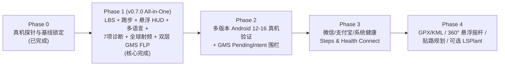

# Kuroko Teleport 分阶段演进路线图（Roadmap）

本文档规划 **Kuroko Teleport** 从底层探针定型到全场景高拟真仿真的 5 个阶段。各阶段严格遵循 **“零猜测实测驱动 + 目标 App 零注入 + 最小割系统侧隔离”** 工程原则推进。

---

## Phase 0：Android 17 (API 37) 真机只读探针与架构定型（✅ 已完成）

**目标**：在不修改目标设备任何文件的前提下，彻底消除 Android 17 (API 37) ARM64 测试设备（HyperOS 4）底层不确定性，做到零猜测编程。

- **已完成核心成果**：
  - 采集实测设备画像：Android 17 (API 37) 高通 `qti` ARM64 平台，纯 `arm64-v8a`，ELF `PT_LOAD p_align=0x4000` (16KB 页对齐)，`PT_GNU_PROPERTY=0x3` (ARM64 BTI + PAC 全开)。
  - 完整拉取并离线解析 7 个系统核心产物：`libsensorservice.so`、`libsensor.so`、`services.jar`、`miui-services.jar`、`service-wifi.jar`、`service-connectivity.jar`、`TeleService.apk`。
  - 实锤 `libsensorservice.so` 未开启 `-Bsymbolic`，确立“纯 PLT/GOT 零 Inline Hook”安全路线并实测 `sizeof(sensors_event_t) == 0x68`。
  - 实锤 Android 17 Mainline APEX jarjar 重定位类名（`com.android.wifi.x...ParceledListSlice` 与 `android.net.connectivity.com.android.server.ConnectivityService`）及 HyperOS 4 专属避坑类（`GpsProxyManager`、`MiuiBlurLocationManagerImpl`）。

---

## Phase 1：国内主流 LBS SDK + 运动计步类应用全闭环（✅ 已完成）

**当前统一基线**：**Kuroko Teleport `v0.7.0`** (`versionCode=13`, `IPC=3`, `SHM=2`) — All-in-One 单包刷入 **`dist/kuroko-teleport-ksu-module.zip`**（内嵌 `ZIP_STORED` `apk/kuroko.apk`）。

**目标**：在不向任何目标第三方 App 注入代码的前提下，实现对主流地图 LBS 定位 SDK 以及第三方运动计步类应用的全链路仿真——即使在室内将手机平放桌面，也能稳定输出平滑轨迹、合法卫星/NMEA 与抗频域检测的同步计步及 5 路 IMU 波形，并具备单包一体分发、四端严格版本锁定与全链路可扩展多语言体验。

- **版本演进与已完成交付**：
  - **`v0.1.0`（初版全链路闭环）**：完成 16KB Seqlock `KurokoShm`、50Hz 物理守护进程、18 星 GNSS/NMEA、Zygisk `libsensorservice.so` 纯 PLT Hook + 40Hz 计步主动注入、LSPosed 系统侧 1Hz 推包泵 + APEX Wi-Fi 双通道 + 双进程基站 + HyperOS 4 豁免、`boot-guard` 防砖与开源 MapLibre 主控 App。
  - **`v0.1.1`（Android 17 真机 SELinux 修正与地图定位首通）**：真机启动零 Bootloop 通过；改为 `/proc/self/fd/<g_memfd>` 只读句柄 `g_memfd_ro` 跨进程分发彻底消除 `tmpfs` `{ write }` SELinux 告警，新增 `loc_shm`/`phone_shm` 上报与 `/data/adb/kuroko/daemon.log` 持久日志；**真机主流地图应用实测通过**。
  - **`v0.2.0`（运动学增强 + Braun 亮色新拟态重构）**：守护进程新增重复圈数上限 `max_laps`（4 参 `SET_ROUTE`）与双时间尺度 OU 配速波动 `SET_PACE_VAR`；主控 App 全面升级 Braun 亮色新拟态双栏 UI、收藏点位库 `PointStore`、预计完成时间/剩余 ETA、`HelpSheet` 及 4 组 GCJ-02 地图图层标记。
  - **App `v0.3.0` / `v0.3.1`（手势微动效、三层场景方案与格式化加固）**：持久手柄真实垂直拖拽弹簧底栏、逐帧跟随右侧悬浮工具栏、三层工作区记忆与完整场景方案（含剪贴板 JSON 导入导出与长按自定义速度预设）、彻底修复 `UnknownFormatConversionException` 并加固剪贴板与重复 ID 防崩溃。
  - **引擎 `v0.3.0` + App `v0.4.0`（多句柄计步改造 + `S✓` 自检 + 后台悬浮控制窗）**：`sepolicy.rule` 补齐 `zygote` 域 5 条策略；升级 8 点纯 PLT/GOT + 三层多句柄发现覆盖 Non-wakeup/Wakeup 双句柄；修复每连接 `>=1000` 单调计步与复跑首包；新增 `TYPE_ORIENTATION (3)` 方向角改写；打通 `L✓ P✓ S✓` 三灯；**后台悬浮控制窗（Floating HUD，✅ 已完成）**落地（`FloatingOverlayService` + `KurokoRuntime`、边缘吸附胶囊、`252dp` 展开控制台、`specialUse` 通知栏快捷控制、动态 `FLAG_SECURE` 防截屏）。
  - **引擎 `v0.3.1` + App `v0.4.1`（双命名空间根因根治 + 自愈 ELF64 GOT 看门狗 + 内置传感器自检）**：彻底删除 C `dlopen` 消除 Android 17 Zygisk 隔离命名空间双副本陷阱，主路径改用 JNI `java.lang.System.load` 加载至 `default` 命名空间，辅以纯 C++ ARM64 ELF64 `.rela.plt` GOT 自愈看门狗（`PROT_EXEC` 重定位守卫）；打通 `kuroko.sensor.diag` -> `STATUS` `sensor_diag` 遥测与设置页内置 **「计步 / IMU 传感器自检」**面板。
  - **`v0.5.0` All-in-One（统一单包分发 + 四端严格版本锁定 + 哨兵过滤）**：建立 `version.properties` 唯一事实源；All-in-One 模块 ZIP 以 `ZIP_STORED` 内嵌 APK，`customize.sh` 验签后流式安装并立即回收 `$MODPATH/apk/`（PMS 离线自动暂存 `pending_apk` 由 `service.sh` 补装），签名冲突与 `uninstall.sh` 严禁卸载保留路线；`SaveSensorUsageItem` 过滤 `arg4=-1` 哨兵；全链路实施四端严格版本锁定状态机。
  - **`v0.6.0` 数据驱动多语言（CHS / EN 全覆盖 + 零硬编码三步扩展，✅ 已完成）**：
    - 抽离 437 组 100% 对称 Android 字符串（`strings.xml` 246 键 + `strings_modules.xml` 191 键，含 LSPosed 双语描述），配置 `res/xml/locales_config.xml` 接入 Android 13+ 原生 Per-App Language，非 `xposed/` 代码零残留硬编码中文与零 `if (lang == "zh")` 分支。
    - 实现注册表驱动 `AppLocaleManager.kt`（母语自称 `SUPPORTED_LANGUAGES`）+ 设置页可扩展 `FlowRow` 选择器 + `FloatingOverlayService` 接收 `ACTION_REFRESH_LOCALE` 实时重建悬浮窗与通知栏 + `RouteStore` `builtInKey` 预设本地化 + `GeocoderClient` 动态 BCP-47 `accept-language`。
    - 守护进程新增 `SET_LANG <auto|BCP-47>`（原子写 `0600` `/data/adb/kuroko/lang`）；`customize.sh` 实现通用 BCP-47 级联加载（`en.sh -> <primary>.sh -> <script-region>.sh -> <region>.sh`）并安全动态本地化 `$MODPATH/module.prop` 描述后清理 `$MODPATH/lang/`；`build_module.py` 动态扫描并审计 `module_template/lang/*.sh`。
  - **`v0.6.1` 全栈一致性定型与 CI/Release 工程化（✅ 已完成）**：
    - 补齐 Android 13–17 Adaptive + Monochrome 桌面图标、`24dp` 前台保活通知栏矢量图标（`ic_stat_kuroko.xml`）及多密度兼容资源，并将用户可见文案统一泛化为通用 Android 表达；落地跨平台构建脚本、`scripts/audit_i18n.py` 与双 GitHub Actions 工作流（`ci.yml` / `release.yml`）。
  - **`v0.6.2` 应用内诊断中心、自动体检、脱敏日志包与跨版本加固（✅ 已完成）**：
    - 落地零常驻后台的 **应用内诊断与日志中心（`DiagnosticsDialog.kt`）**：`DiagnosticCollector.kt` 单次有界只读采集 5 源日志（两阶段 `logcat`、零误报 SELinux AVC 过滤、严格防跨模块 LSPosed 白名单与精确 ELF 实例数解析），配合 400 条内存事件环形缓冲 `AppLogBuffer.kt` 与 5 项本地自动体检。
    - 全链路强制隐私脱敏 + 零新增敏感权限导出（复制 Markdown 摘要、作用域 `FileProvider` `cache/diagnostics/` 分享 6 文件 ZIP、SAF `CreateDocument` 保存 ZIP）；守护进程 `/data/adb/kuroko/daemon.log` 256 KB 原子轮转；新增双语 GitHub Issue 表单 `.github/ISSUE_TEMPLATE/bug_report.yml`。
    - **跨版本与防崩溃加固**：Native NDK 编译目标下探至 **`android-31`**（零 API>31 Bionic 依赖）；`sensor_hook.cpp` 升级为 ABI 安全 20 变体 `HookSlot` 多版本 Android 12–17 候选符号表 + `.rela.plt` 预过滤 + `CONN_C1 | SEND_EVENTS` 预检核心门禁 + 静态 `g_plt_orig_slots` 无条件同步与包装函数回退，彻底杜绝半重定位或缺失符号引发 `system_server` 崩溃。
  - **`v0.6.3` Release 版本更新检查与 KernelSU `updateJson` 支持（✅ 已完成）**：
    - 新增仅针对 GitHub Releases 的应用内更新检查（`update/UpdateChecker.kt`、`ui/UpdateDialog.kt`，接入 `MainActivity` 与 `SettingsDialog`），并在 `build_module.py` 与 `.github/workflows/release.yml` 集成 KernelSU `updateJson` 静态元数据发布。
  - **`v0.7.0` 全球地理感知射频仿真（虚拟 4G/5G 基站 + 虚拟 Wi-Fi 列表 + 蓝牙/BLE 隔离与 iBeacon + 国家码，✅ 已实现）**：
    - **协议与共享内存升级（`SHM=2` / `IPC=3`）**：`KurokoShm v2` 在 16KB 页内新增 `KurokoRfHeader`、`KurokoCell[8]`、`KurokoWifiAp[16]`、`KurokoBleDevice[16]`；新增 4 组策略位（`SPOOF_WIFI`/`SPOOF_CELL`/`HIDE_BLE`/`SPOOF_BLE`）与 3 预设（全量拟真 `0x3E7` / 严格隐藏 `0x13F` / 同城户外 `0x02F`）；TCP IPC v3 新增 `SET_RF_CONFIG`/`SET_RF_CELLS`/`SET_RF_WIFIS`/`SET_RF_BEACONS` 并扩展 `STATUS` 射频遥测。
    - **全球射频与地磁合成引擎**：`RfSynthesizer`（`native/daemon/rf_synth.{h,cpp}`）内置覆盖全球主流地区的运营商 MCC/MNC、4G/5G 频段与 Wi-Fi 法规信道表，1Hz 合成时空连续基站（Cost-231 衰落 + 3 dB 切换迟滞）、微网格 Wi-Fi AP 列表与 30B Apple `0x004C` iBeacon 广播；`sim_engine.cpp` 升级南北半球精确的纬度感知偶极子地磁模型。
    - **三进程系统侧射频 Hook**：`VirtualCellBuilder.kt` + `TelephonyHook.kt`（虚拟 LTE/NR `CellInfo`、`ServiceState` 含 `NetworkRegistrationInfo.mRplmn`、`Kuroko-1Hz-Tel` 跨区热切换与 `IOnSubscriptionsChangedListener` 主动推送，以及 `ISub` `SubscriptionManagerService`/`SubscriptionController` 按 UID 改写 `SubscriptionInfo`）；`VirtualWifiBuilder.kt` + `WifiConnectivityHook.kt`（虚拟 `ScanResult` + 802.11d Country IE + `getCountryCode` + 虚拟已连 `WifiInfo`）；`BluetoothHook.kt`（`system_server` `service-bluetooth.jar` 缓存远程 Binder 经仅 Root `KUROKO_BINDER_TX_GET_BT_BINDER` 桥接至 `com.android.bluetooth` `/apex/com.android.bt`，双兼容 Android 17 `IAdapter` 与 `IBluetooth`，实现按 UID 抑制真实 BLE/经典蓝牙发现与 1Hz 虚拟 iBeacon 注入，`bt_shm` 可选绝不锁死模拟）；并在文档明确记录零注入边界（进程内直读 `/dev/__properties__` `gsm.*` 的 6 个 `TelephonyManager` 快捷方法刻意不改写）。
    - **主控端配置与实测导入**：新增 `RfConfigStore`、`RfLiveImporter`（一键导入当前周边实测基站/Wi-Fi/BLE iBeacon 及按需可选 OpenCelliD 查询）、`TargetAppSheet` 三态微调与 `RfConfigDialog`（含可选 `GMS G✓/G-` 徽章与 `SET_GMS` 零驻留开关），并在诊断中心升级为 **7 项自动体检**（集成可选蓝牙 `B` 与可选 GMS 融合定位 `G` 检查、`KurokoGmsHook` 抓取、`gmscore_app` AVC 过滤与 OpenCelliD Token 脱敏）。
    - **双层海外 GMS 融合定位（FLP）与 Play Integrity 保护**：**Layer 1**（`LocationHook.kt` 严格零串扰 `WorkSource` 归因，仅在全部应用 UID 均命中 `KUROKO_POLICY_LOCATION` 时接管系统/OEM/microG 代理）；**Layer 2**（`kuroko_zygisk` `gms_hook.{h,cpp}` 严禁在 LSPosed 勾选 GMS，对 `com.google.android.gms.unstable`/`.ui`/其他应用无条件 `DLCLOSE`，仅在 `com.google.android.gms` / `.persistent` 通过 `PT_GNU_RELRO` 纯原子 Vtable 替换在 AIDL 线层按内核 `calling_uid` 接管 `IGoogleLocationManagerService` 与出站 `ILocationCallback`/`ILocationListener`/`ILocationStatusCallback`，JNI 构造洁净 `Location` 且内建 1Hz 室内主动推包泵 `Kuroko-1Hz-GMS`，零污染 GMS 缓存/CHRE/Find My Device）。
- **阶段收口验收（✅ Phase 1 与 `v0.7.0` 核心射频实机已通过 · GMS 真机回归待测）**：
  - Phase 1 全链路已在 Android 17 测试设备验收通过；`v0.7.0` 四端版本对齐、`L✓ P✓ S✓ B✓`（含零 `bluetooth` AVC）、跨国/跨区 4G/5G 基站、`ServiceState` 热切换与 `ISub` 本地 SIM 订阅改写均已实机验收通过；双层 GMS FLP 待在含 GMS 环境下完成真机回归验收。

---

## Phase 2：多版本 Android 12–17 泛化与海外 GMS FLP 进阶适配（🚧 进行中）

**目标**：将 Native 传感器/计步引擎从当前已实测的 Android 17 扩展至 **Android 12–17 (API 31–37)** 主流版本与多厂商 ROM，并完善海外 Google Play Services (`com.google.android.gms`) 融合定位与后台地理围栏场景。

- **轨道 1：多版本 Android 12–17 传感器 ABI 与多 ROM 泛化**
  1. **多版本 `libsensorservice.so` 符号表与 `android-31` 编译基线（✅ 代码基线已落地 · 待社区多机型真机验证）**：Native NDK 构建目标已下探至 `android-31`（零 API>31 Bionic 依赖），`native/zygisk/sensor_hook.cpp` 已引入覆盖 API 31–37 的 `HookSlot` 候选符号表（各参数变体独立精确签名包装 + 位掩码去重计数 + 未知 OEM 符号 `LOGW` 自动转储）；后续将结合社区在 Android 12–16 多机型导出的脱敏诊断包持续补齐非标 OEM 符号变体与运行时偏移校验。
  2. **跨厂商 ROM 可选适配模块**：在保持现有 HyperOS 豁免模块独立运行的前提下，补充其他主流 ROM（AOSP / Pixel、ColorOS、OriginOS、One UI 等）的定位代理、省电冻结与模糊定位可选适配钩子，全部做到反射弱绑定、按类存在性静默按需启用。
- **轨道 2：海外 GMS FusedLocationProvider (FLP) / `WorkSource` 深度适配（✅ 核心双层已落地 `v0.7.0` · 待真机回归与围栏扩展）**
  1. **Layer 1 严格零串扰 `WorkSource` 归因（✅ 已完成，`v0.7.0`）**：`LocationHook.kt` 完整解析 `WorkSource` / `AttributionSource` 调用链，仅在所有应用 UID 均启用 `KUROKO_POLICY_LOCATION` 时接管代理注册，彻底避免混合多客户端串扰。
  2. **Layer 2 进程隔离 GMS AIDL 线层接管与 Play Integrity 保护（✅ 已完成，`v0.7.0` · 待实机回归验收）**：`kuroko_zygisk` `gms_hook.{h,cpp}` 仅在 `com.google.android.gms` / `.persistent` 驻留（对 `.unstable` 无条件卸载，支持 `SET_GMS 0` 零驻留关闭），纯原子 Vtable 替换完整覆盖前台/回调型 `FusedLocationProviderClient`（`requestLocationUpdates`/`getLastLocation`/`getCurrentLocation`/`LocationAvailability`）与 1Hz 室内主动推包；**已知边界**：若 Zygisk Next DenyList 阻止 GMS 进程加载模块则优雅回退至 Layer 1。
  3. **`PendingIntent` 后台地理围栏（Geofencing）拦截（📋 规划中）**：后续版本扩展支持基于 `PendingIntent` 的 GMS 后台定位与地理围栏投递。
  4. **高阶 `GnssMeasurements` 原始观测合成（可选）**：针对校验原始伪距、载波相位与 `GnssClock` 的极严风控 App，升级当前“安全抑制降级”策略为同源开普勒星历伪距与多普勒频移合成器。

---

## Phase 3：微信运动 / 支付宝 / 系统健康计步生态适配（📋 规划中）

**目标**：打通不直接实时订阅 `SensorManager`，而是读取系统计步聚合库或健康数据平台的计步榜单场景（微信运动、支付宝运动、小米运动健康、Google Fit / Health Connect）。

- **关键技术路径**：
  1. **系统计步聚合服务适配**：基于 Phase 0 已定位的 `com.miui.server.stepcounter.StepCounterManagerService` 及内容提供者 `com.miui.providers.steps`（并调研其他 ROM 对应计步服务），设计独立的“虚拟步数账本”叠加机制，支持按查询方 UID 返回叠加后的当日步数或写入指定目标时间桶，同时不影响真实计步基准。
  2. **Android Health Connect (`android.health.connect`) 适配**：支持在受控开关下，将虚拟跑步会话按标准规范同步至 Health Connect，或拦截目标 App 对 Health Connect 历史步数记录的交叉比对。

---

## Phase 4：全维度环境信号伪造（✅ `v0.7.0` 已落地）、交互增强与架构演进（🔭 持续演进）

**目标**：将环境信号隔离从“安全脱敏隐藏”提升为“按 UID 可切换的时空一致全维度伪造”，覆盖蜂窝基站、Wi-Fi 列表与蓝牙/BLE 三大无线信道，同时完善路线互操作体验并探索去 LSPosed 依赖的极简架构。

- **轨道 3：虚拟蜂窝基站伪造（Virtual Cell Tower Spoofing · ✅ 已完成，`v0.7.0`）**
  - **时空连续 4G/5G 基站与国家码合成**：`native/daemon/rf_synth.cpp` 基于全球地理区域表与 450m 网格合成合理临近 `CellInfoLte` / `CellInfoNr`（`MCC`/`MNC`/`TAC`/`CI`/`PCI`/`EARFCN`/`NR-ARFCN`/`RSRP`/`RSRQ`/`SINR`/`TimingAdvance`），支持 Cost-231 衰落、OU 波动与 3 dB 切换迟滞，并支持用户固定基站、周边实测一键导入及可选 OpenCelliD 按需查询。
  - **单应用三态蜂窝策略**：扩展 `KurokoShm v2` 策略位与 `TargetAppSheet` 三态选择器，在 `PhoneInterfaceManager`（`com.android.phone`）与 `TelephonyRegistry`（`system_server`）双进程支持按 UID 切换 **`透传 (Pass)` / `隐藏 (Hide)` / `虚拟基站伪造 (Spoof)`** 及网络/可选 SIM 国家码与运营商改写。
- **轨道 4：虚拟 Wi-Fi AP 列表伪造（Virtual Wi-Fi AP List Spoofing · ✅ 已完成，`v0.7.0`）**
  - **地理一致周边 AP 列表与国家码合成**：`VirtualWifiBuilder.kt` + `WifiConnectivityHook.kt` 在 APEX `service-wifi.jar` 中按虚拟坐标 80m 3×3 微网格合成合理周边 `ScanResult` 列表（合法单播 OUI、区域 SSID、合规 2.4GHz/5GHz 信道与 `centerFreq0`、距离衰减 RSSI 与 **802.11d Country IE `id=7`**），按 UID 覆写 `getCountryCode` 与可选虚拟已连 `WifiInfo`，支持 **`透传 (Pass)` / `隐藏 (Hide)` / `虚拟 Wi-Fi 列表 (Spoof)`** 三态切换及用户固定热点。
- **轨道 5：蓝牙 / BLE 隔离与伪造（Bluetooth / BLE Isolation & Spoofing · ✅ 已完成，`v0.7.0`）**
  - **按 UID 扫描抑制与 1Hz 虚拟 iBeacon 注入**：`BluetoothHook.kt` 在 `system_server`（`service-bluetooth.jar`）缓存 `IBluetooth` Binder 并经仅 Root 权限 `KUROKO_BINDER_TX_GET_BT_BINDER` 桥接 `g_memfd_ro` 至 `com.android.bluetooth`（`/apex/com.android.bt`），在 `AdapterBinder`/`ScanController`/`ScanBinder`/`ScannerMap`（及 Android 12–15 `GattService` 回退）与 `RemoteDevices` 中按目标 UID 抑制真实 BLE/经典蓝牙发现，1Hz 注入合规 30B Apple `0x004C` iBeacon（校验调用方 `ScanFilter`）与可选环境 BLE，零影响已配对蓝牙耳机/手表。
- **交互、本地化社区扩展与路线能力增强（📋 规划中）**：
  - **更多社区语言包**：基于三步零硬编码扩展机制，按需扩展 `zh-TW`、`ja`、`ko` 等语种。
  - **GPX / KML / TCX 轨迹导入与导出**：在现有剪贴板 JSON 方案导入导出基础上，增加行业标准 GPX/KML/TCX 轨迹互操作。
  - **虚拟方向摇杆（Floating Joystick）**：在后台悬浮 HUD 基础上扩展 360° 虚拟摇杆手势模式。
  - **开放路网自动贴路规划**：可选对接 OSRM / Valhalla 开源路由服务，实现两点间自动沿人行道/道路生成平滑轨迹。
- **架构演进：可选内嵌 LSPlant 去 LSPosed 化**：
  - 调研并构建可选分支：在 Zygisk `postServerSpecialize`（及 `com.android.phone` 专属条件判断）中直接内嵌 **LSPlant** 完成对 `system_server` 与 `com.android.phone` 的 Java 方法 Hook，实现 **“纯 KSU2 + Zygisk 单模块 ZIP + 主控 App”** 极简部署（同时保留标准 LSPosed 轻量模式）。
