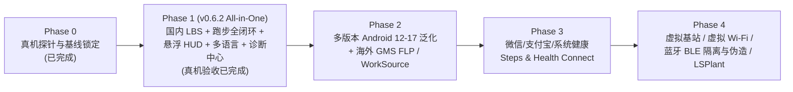

# Kuroko Teleport 分阶段演进路线图（Roadmap）

本文档规划 **Kuroko Teleport** 从底层探针定型到全场景高拟真仿真的 5 个阶段。各阶段严格遵循 **“零猜测实测驱动 + 目标 App 零注入 + 最小割系统侧隔离”** 工程原则推进。

---

## Phase 0：Android 17 (API 37) 真机只读探针与架构定型（✅ 已完成）

**目标**：在不修改目标设备任何文件的前提下，彻底消除 Android 17 (API 37) ARM64 测试设备（HyperOS 4）底层不确定性，做到零猜测编程。

- **已完成核心成果**：
  - 采集实测设备画像：Android 17 (API 37) 高通 `qti` ARM64 平台，纯 `arm64-v8a`，ELF `PT_LOAD p_align=0x4000` (16KB 页对齐)，`PT_GNU_PROPERTY=0x3` (ARM64 BTI + PAC 全开)。
  - 完整拉取并离线解析 7 个系统核心产物：`libsensorservice.so`、`libsensor.so`、`services.jar`、`miui-services.jar`、`service-wifi.jar`、`service-connectivity.jar`、`TeleService.apk`。
  - 实锤 `libsensorservice.so` 未开启 `-Bsymbolic`，确立“纯 PLT/GOT 零 Inline Hook”安全路线并实测 `sizeof(sensors_event_t) == 0x68`。
  - 实锤 Android 17 Mainline APEX jarjar 重定位类名（`com.android.wifi.x...ParceledListSlice` 与 `android.net.connectivity.com.android.server.ConnectivityService`）及 HyperOS 4 专属避坑类（`GpsProxyManager`、`MiuiBlurLocationManagerImpl`）。

---

## Phase 1：国内主流 LBS SDK + 运动计步类应用全闭环（✅ 已完成）

**当前统一基线**：**Kuroko Teleport `v0.6.2`** (`versionCode=11`, `IPC=2`, `SHM=1`) — All-in-One 单包刷入 **`dist/kuroko-teleport-ksu-module.zip`**（内嵌 `ZIP_STORED` `apk/kuroko.apk`）。

**目标**：在不向任何目标第三方 App 注入代码的前提下，实现对主流地图 LBS 定位 SDK 以及第三方运动计步类应用的全链路仿真——即使在室内将手机平放桌面，也能稳定输出平滑轨迹、合法卫星/NMEA 与抗频域检测的同步计步及 5 路 IMU 波形，并具备单包一体分发、四端严格版本锁定与全链路可扩展多语言体验。

- **版本演进与已完成交付**：
  - **`v0.1.0`（初版全链路闭环）**：完成 16KB Seqlock `KurokoShm`、50Hz 物理守护进程、18 星 GNSS/NMEA、Zygisk `libsensorservice.so` 纯 PLT Hook + 40Hz 计步主动注入、LSPosed 系统侧 1Hz 推包泵 + APEX Wi-Fi 双通道 + 双进程基站 + HyperOS 4 豁免、`boot-guard` 防砖与开源 MapLibre 主控 App。
  - **`v0.1.1`（Android 17 真机 SELinux 修正与地图定位首通）**：真机启动零 Bootloop 通过；改为 `/proc/self/fd/<g_memfd>` 只读句柄 `g_memfd_ro` 跨进程分发彻底消除 `tmpfs` `{ write }` SELinux 告警，新增 `loc_shm`/`phone_shm` 上报与 `/data/adb/kuroko/daemon.log` 持久日志；**真机主流地图应用实测通过**。
  - **`v0.2.0`（运动学增强 + Braun 亮色新拟态重构）**：守护进程新增重复圈数上限 `max_laps`（4 参 `SET_ROUTE`）与双时间尺度 OU 配速波动 `SET_PACE_VAR`；主控 App 全面升级 Braun 亮色新拟态双栏 UI、收藏点位库 `PointStore`、预计完成时间/剩余 ETA、`HelpSheet` 及 4 组 GCJ-02 地图图层标记。
  - **App `v0.3.0` / `v0.3.1`（手势微动效、三层场景方案与格式化加固）**：持久手柄真实垂直拖拽弹簧底栏、逐帧跟随右侧悬浮工具栏、三层工作区记忆与完整场景方案（含剪贴板 JSON 导入导出与长按自定义速度预设）、彻底修复 `UnknownFormatConversionException` 并加固剪贴板与重复 ID 防崩溃。
  - **引擎 `v0.3.0` + App `v0.4.0`（多句柄计步改造 + `S✓` 自检 + 后台悬浮控制窗）**：`sepolicy.rule` 补齐 `zygote` 域 5 条策略；升级 8 点纯 PLT/GOT + 三层多句柄发现覆盖 Non-wakeup/Wakeup 双句柄；修复每连接 `>=1000` 单调计步与复跑首包；新增 `TYPE_ORIENTATION (3)` 方向角改写；打通 `L✓ P✓ S✓` 三灯；**后台悬浮控制窗（Floating HUD，✅ 已完成）**落地（`FloatingOverlayService` + `KurokoRuntime`、边缘吸附胶囊、`252dp` 展开控制台、`specialUse` 通知栏快捷控制、动态 `FLAG_SECURE` 防截屏）。
  - **引擎 `v0.3.1` + App `v0.4.1`（双命名空间根因根治 + 自愈 ELF64 GOT 看门狗 + 内置传感器自检）**：彻底删除 C `dlopen` 消除 Android 17 Zygisk 隔离命名空间双副本陷阱，主路径改用 JNI `java.lang.System.load` 加载至 `default` 命名空间，辅以纯 C++ ARM64 ELF64 `.rela.plt` GOT 自愈看门狗（`PROT_EXEC` 重定位守卫）；打通 `kuroko.sensor.diag` -> `STATUS` `sensor_diag` 遥测与设置页内置 **「计步 / IMU 传感器自检」**面板。
  - **`v0.5.0` All-in-One（统一单包分发 + 四端严格版本锁定 + 哨兵过滤）**：建立 `version.properties` 唯一事实源；All-in-One 模块 ZIP 以 `ZIP_STORED` 内嵌 APK，`customize.sh` 验签后流式安装并立即回收 `$MODPATH/apk/`（PMS 离线自动暂存 `pending_apk` 由 `service.sh` 补装），签名冲突与 `uninstall.sh` 严禁卸载保留路线；`SaveSensorUsageItem` 过滤 `arg4=-1` 哨兵；全链路实施四端严格版本锁定状态机。
  - **`v0.6.0` 数据驱动多语言（CHS / EN 全覆盖 + 零硬编码三步扩展，✅ 已完成）**：
    - 抽离 437 组 100% 对称 Android 字符串（`strings.xml` 246 键 + `strings_modules.xml` 191 键，含 LSPosed 双语描述），配置 `res/xml/locales_config.xml` 接入 Android 13+ 原生 Per-App Language，非 `xposed/` 代码零残留硬编码中文与零 `if (lang == "zh")` 分支。
    - 实现注册表驱动 `AppLocaleManager.kt`（母语自称 `SUPPORTED_LANGUAGES`）+ 设置页可扩展 `FlowRow` 选择器 + `FloatingOverlayService` 接收 `ACTION_REFRESH_LOCALE` 实时重建悬浮窗与通知栏 + `RouteStore` `builtInKey` 预设本地化 + `GeocoderClient` 动态 BCP-47 `accept-language`。
    - 守护进程新增 `SET_LANG <auto|BCP-47>`（原子写 `0600` `/data/adb/kuroko/lang`）；`customize.sh` 实现通用 BCP-47 级联加载（`en.sh -> <primary>.sh -> <script-region>.sh -> <region>.sh`）并安全动态本地化 `$MODPATH/module.prop` 描述后清理 `$MODPATH/lang/`；`build_module.py` 动态扫描并审计 `module_template/lang/*.sh`。
  - **`v0.6.1` 全栈一致性定型与 CI/Release 工程化（✅ 已完成）**：
    - 补齐 Android 13–17 Adaptive + Monochrome 桌面图标、`24dp` 前台保活通知栏矢量图标（`ic_stat_kuroko.xml`）及多密度兼容资源，并将用户可见文案统一泛化为通用 Android 表达；落地跨平台构建脚本、`scripts/audit_i18n.py` 与双 GitHub Actions 工作流（`ci.yml` / `release.yml`）。
  - **`v0.6.2` 应用内诊断中心、自动体检、脱敏日志包与 Issue 表单（✅ 已通过 5/5 Gate 独立审计，0 缺陷）**：
    - 落地零常驻后台的 **应用内诊断与日志中心（`DiagnosticsDialog.kt`）**：`DiagnosticCollector.kt` 单次有界只读采集 5 源系统/引擎/LSPosed/传感器日志，配合 400 条内存事件环形缓冲 `AppLogBuffer.kt` 与 5 项本地自动体检（Root/Daemon、四端版本锁、LSPosed L/P、Zygisk 传感器 S 区分多映射与 Android ABI 未适配、SELinux AVC）。
    - 全链路强制隐私脱敏（永不读 `token`、剥离 API Key / 坐标 / NMEA / MAC / 邮箱与无关应用日志，默认开启目标包名匿名化）+ 零新增敏感权限导出（复制 Markdown 摘要、作用域 `FileProvider` `cache/diagnostics/` 分享 6 文件 ZIP、SAF `CreateDocument` 保存 ZIP）。
    - 守护进程新增 `/data/adb/kuroko/daemon.log` 256 KB 原子轮转（截取换行对齐 128 KB 尾部写入 `0600` `.tmp` 后 `rename()`）；新增双语 GitHub Issue 反馈表单 `.github/ISSUE_TEMPLATE/bug_report.yml`（字符串库扩展至 491/491 对称键）；优化诊断采集信噪比（两阶段 `logcat`、零误报 SELinux AVC 过滤、严格防跨模块 LSPosed 白名单与精确 ELF 实例数解析）。
    - **跨版本兼容基线加固**：Native NDK 编译目标下探至 **`android-31`**（与 App `minSdk 31` 一致，零 API>31 Bionic 符号依赖）；`sensor_hook.cpp` 升级为 ABI 安全的 **`HookSlot` 多版本 Android 12–17 候选符号表**（各参数变体独立精确签名包装与 `std::atomic` 原指针防 ARM64 栈参截断、位掩码防重复计数，以及未知 OEM ROM 未命中时 `LOGW` 自动转储候选符号）。
- **阶段收口验收（✅ 已完成）**：
  - 已在 Android 17 测试设备完成全链路真机验收：零 Bootloop 启动、SELinux 零拒绝握手、All-in-One 单包双语流式安装与空间回收、`L✓ P✓ S✓` 与四端 `v0.6.2(11)` 全绿对齐、应用内诊断中心自动体检与脱敏 ZIP 导出、内置传感器自检、主流地图跨城定位及运动计步类应用室内桌面静止长时跑圈验收全部通过。

---

## Phase 2：多版本 Android 12–17 泛化与海外 GMS FLP 适配（📋 规划中）

**目标**：将 Native 传感器/计步引擎从当前已实测的 Android 17 扩展至 **Android 12–17 (API 31–37)** 主流版本与多厂商 ROM，并解决海外依赖 Google Play Services (`com.google.android.gms`) 融合定位提供器（FLP）的地图与运动类应用间接请求定位时的归因与缓存串扰问题。

- **轨道 1：多版本 Android 12–17 传感器 ABI 与多 ROM 泛化**
  1. **多版本 `libsensorservice.so` 符号表与 `android-31` 编译基线（✅ 代码基线已落地 · 待社区多机型真机验证）**：Native NDK 构建目标已下探至 `android-31`（零 API>31 Bionic 依赖），`native/zygisk/sensor_hook.cpp` 已引入覆盖 API 31–37 的 `HookSlot` 候选符号表（各参数变体独立精确签名包装 + 位掩码去重计数 + 未知 OEM 符号 `LOGW` 自动转储）；后续将结合社区在 Android 12–16 多机型导出的脱敏诊断包持续补齐非标 OEM 符号变体与运行时偏移校验。
  2. **跨厂商 ROM 可选适配模块**：在保持现有 HyperOS 豁免模块独立运行的前提下，补充其他主流 ROM（AOSP / Pixel、ColorOS、OriginOS、One UI 等）的定位代理、省电冻结与模糊定位可选适配钩子，全部做到反射弱绑定、按类存在性静默按需启用。
- **轨道 2：海外 GMS FusedLocationProvider (FLP) / `WorkSource` 深度适配**
  1. **`WorkSource` / `AttributionSource` 归因解析**：当目标 App 经由 `com.google.android.gms` 请求底层 `LocationProviderManager` 时，`CallerIdentity.uid` 为 GMS 自身 UID，实际发起方位于 `LocationRequest.getWorkSource()`（或 `AttributionSource` 链）中。在 `system_server` 侧增加多 UID `WorkSource` 拆分识别与回调隔离逻辑，避免污染其他非目标 GMS 客户端。
  2. **GMS 缓存与回调隔离**：评估在 `system_server` FLP Provider 桥接层或受控 GMS 代理边界拦截 `FusedLocationProvider` 的按包缓存（`lastLocation` / `LocationAvailability`）与 `Geofencing` 回调，全程保持目标 App 零注入。
  3. **高阶 `GnssMeasurements` 原始观测合成（可选）**：针对校验原始伪距、载波相位与 `GnssClock` 的极严风控 App，升级当前“安全抑制降级”策略为同源开普勒星历伪距与多普勒频移合成器。

---

## Phase 3：微信运动 / 支付宝 / 系统健康计步生态适配（📋 规划中）

**目标**：打通不直接实时订阅 `SensorManager`，而是读取系统计步聚合库或健康数据平台的计步榜单场景（微信运动、支付宝运动、小米运动健康、Google Fit / Health Connect）。

- **关键技术路径**：
  1. **系统计步聚合服务适配**：基于 Phase 0 已定位的 `com.miui.server.stepcounter.StepCounterManagerService` 及内容提供者 `com.miui.providers.steps`（并调研其他 ROM 对应计步服务），设计独立的“虚拟步数账本”叠加机制，支持按查询方 UID 返回叠加后的当日步数或写入指定目标时间桶，同时不影响真实计步基准。
  2. **Android Health Connect (`android.health.connect`) 适配**：支持在受控开关下，将虚拟跑步会话按标准规范同步至 Health Connect，或拦截目标 App 对 Health Connect 历史步数记录的交叉比对。

---

## Phase 4：全维度环境信号伪造（基站 / Wi-Fi / 蓝牙 BLE）、交互增强与架构演进（🔭 远期演进）

**目标**：将环境信号隔离从“安全脱敏隐藏”提升为“按 UID 可切换的时空一致全维度伪造”，覆盖蜂窝基站、Wi-Fi 列表与蓝牙/BLE 三大无线信道，同时完善路线互操作体验并探索去 LSPosed 依赖的极简架构。

- **轨道 3：虚拟蜂窝基站伪造（Virtual Cell Tower Spoofing）**
  - **时空连续 4G/5G 基站合成**：基于虚拟 WGS-84 坐标（接入离线/在线基站库或确定性区域生成器）合成合理临近 `CellInfoLte` / `CellInfoNr`（包含 `MCC` / `MNC` / `TAC` / `CI` / `PCI` / `EARFCN` / `NR-ARFCN` / `RSRP` / `RSRQ` / `TimingAdvance`），沿模拟运动轨迹平滑切换服务小区与邻区信号强度，彻底规避“有 SIM 卡但零基站”的启发式风控。
  - **单应用三态蜂窝策略**：扩展 `KurokoShm` 单应用策略位与 UI 选择器，在 `PhoneInterfaceManager`（`com.android.phone`）与 `TelephonyRegistry`（`system_server`）双进程支持按 UID 切换 **`透传 (Pass-through)` / `隐藏 (Hide)` / `虚拟基站伪造 (Virtual Spoof)`**。
- **轨道 4：虚拟 Wi-Fi AP 列表伪造（Virtual Wi-Fi AP List Spoofing）**
  - **地理一致周边 AP 列表合成**：在 `WifiServiceImpl.getScanResults`（APEX `service-wifi.jar`）按虚拟坐标与移动轨迹合成合理周边虚拟 `ScanResult` 列表（合法 OUI 段 `BSSID`、自然 `SSID`、2.4GHz/5GHz 频段信道、随距离连续衰减的 `RSSI` 与一致时间戳），并可选配合 `ConnectivityService` 脱敏当前关联 `WifiInfo`。
  - **单应用双态 Wi-Fi 策略**：支持按目标 UID 在 **`隐藏 (Hide)`** 与 **`虚拟 Wi-Fi 列表 (Virtual AP List)`** 之间独立切换。
- **轨道 5：蓝牙 / BLE 隔离与伪造（Bluetooth / BLE Isolation & Spoofing）**
  - **Phase A（按 UID 扫描结果抑制）**：在 `BluetoothManagerService` / `com.android.bluetooth`（`AdapterService` / `ScanManager` / `GattService`）按调用方 UID 屏蔽真实周边 BLE 广播与经典蓝牙扫描发现，封堵室内蓝牙指纹与考勤信标交叉校验泄漏。
  - **Phase B（可配置虚拟 BLE / iBeacon 注入）**：支持按场景配置虚拟 BLE 广播帧与 iBeacon 参数（`UUID`、`Major`、`Minor`、`TxPower` 与距离耦合 `RSSI`），在目标 UID 发起扫描时按时序注入合法 `ScanResult` 回调。
- **交互、本地化社区扩展与路线能力增强**：
  - **更多社区语言包**：基于三步零硬编码扩展机制，按需扩展 `zh-TW`、`ja`、`ko` 等语种。
  - **GPX / KML / TCX 轨迹导入与导出**：在现有剪贴板 JSON 方案导入导出基础上，增加行业标准 GPX/KML/TCX 轨迹互操作。
  - **虚拟方向摇杆（Floating Joystick）**：在后台悬浮 HUD 基础上扩展 360° 虚拟摇杆手势模式。
  - **开放路网自动贴路规划**：可选对接 OSRM / Valhalla 开源路由服务，实现两点间自动沿人行道/道路生成平滑轨迹。
- **架构演进：可选内嵌 LSPlant 去 LSPosed 化**：
  - 调研并构建可选分支：在 Zygisk `postServerSpecialize`（及 `com.android.phone` 专属条件判断）中直接内嵌 **LSPlant** 完成对 `system_server` 与 `com.android.phone` 的 Java 方法 Hook，实现 **“纯 KSU2 + Zygisk 单模块 ZIP + 主控 App”** 极简部署（同时保留标准 LSPosed 轻量模式）。
